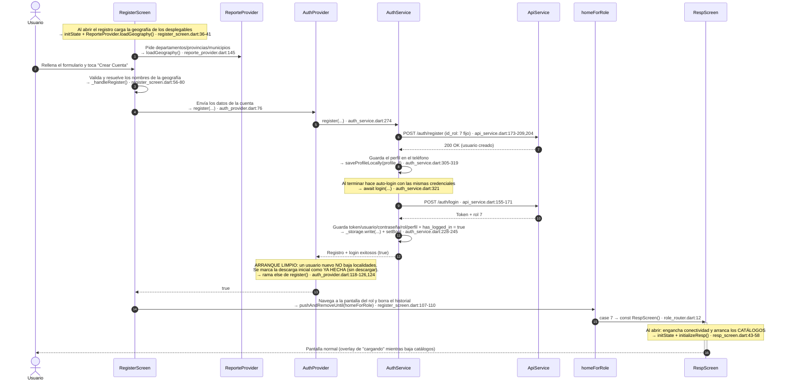
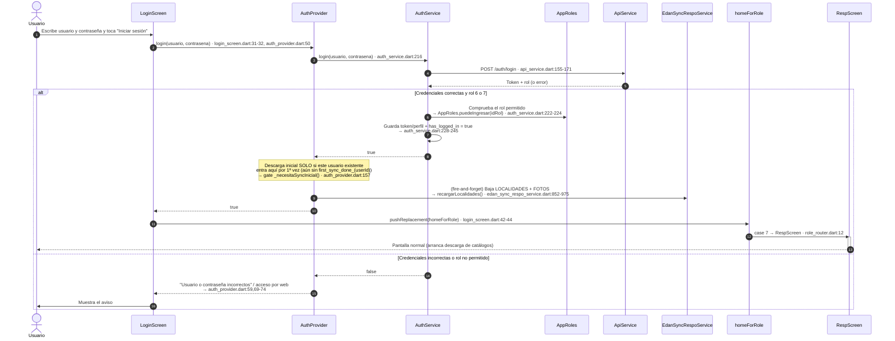
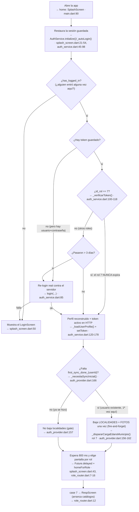
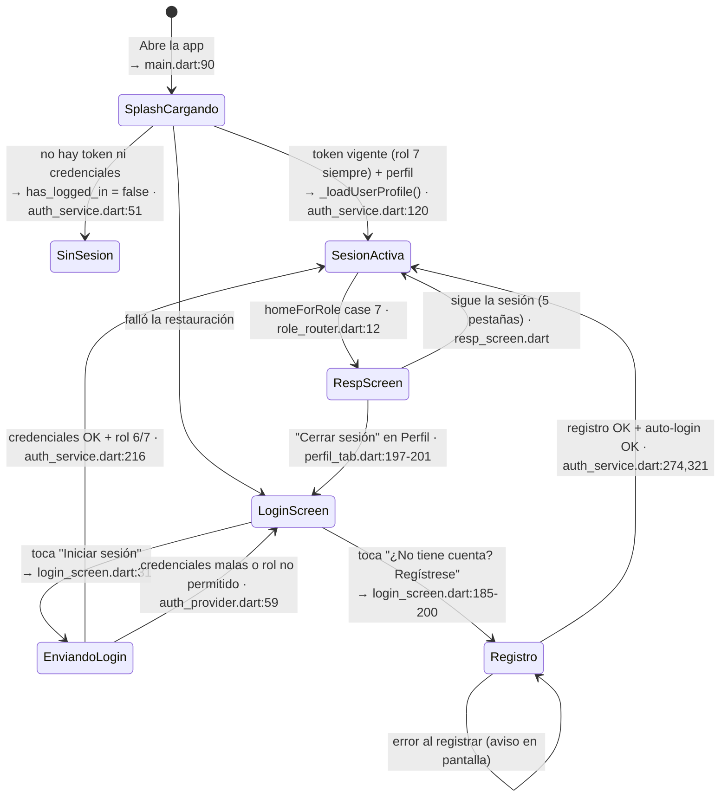

# Diagrama 01 — Rol 7 (RESP): Inicio de sesión y registro

> **Proyecto:** Flutter `APP_REA/REA` (paquete `rea`, v1.1.4+15)
> **Alcance de este documento:** **únicamente** el **inicio de sesión** y el **registro** del rol 7 (RESP), con las **descargas que ocurren después** de cada uno (catálogos, localidades y fotos). Nada más.
> **Roles:** `6 = UGR`, `7 = RESP` (Responsable Local). Solo los roles 6 y 7 pueden entrar en la app (`app_roles.dart:15`). El rol 6 se documenta en `02_rol6_ugr_sesion_y_registro.md`.

---

## Cómo leer estos diagramas (convención)

Cada nodo y cada mensaje de los diagramas está escrito con **dos cosas juntas**:

```
ACCIÓN (qué ocurre, en lenguaje normal)
→ FUNCIÓN (dónde ocurre en el código, para editar) · archivo.dart:línea
```

- La **primera línea** describe **qué está pasando**, en palabras normales.
- La **segunda línea** (empieza con `→`) dice **qué función/archivo** lo hace y su línea.

Así sabemos exactamente **qué ocurre** y **dónde tocar** el código. Para pedir un cambio, cita las dos partes.

---

## 0. Actores, endpoints y almacenamiento

| Actor / componente | Archivo | Qué es |
|---|---|---|
| `LoginScreen` | `lib/screens/login_screen.dart` | Pantalla de login (usuario/carnet + contraseña) y enlace a registro. |
| `RegisterScreen` | `lib/screens/register_screen.dart` | Registro de **Responsable Local** (rol 7 forzado). |
| `SplashScreen` | `lib/screens/splash_screen.dart` | Arranque: decide entre sesión guardada y Login (auto-login). |
| `AuthProvider` | `lib/providers/auth_provider.dart` | Envuelve `AuthService` y dispara la **descarga inicial** tras autenticar. |
| `AuthService` | `lib/services/auth_service.dart` | Login/registro/auto-login/logout + persistencia de sesión. |
| `ApiService` | `lib/services/api_service.dart` | Capa HTTP (endpoints `/auth/*` y `/edan/*`). |
| `ReporteProvider` | `lib/providers/reporte_provider.dart` | **Catálogos generales** (una vez por dispositivo) + geografía. |
| `EdanSyncRespoService` | `lib/services/edan/edan_sync_respo_service.dart` | Baja **localidades** ("mis reportes") y **fotos** del rol 7. |
| `homeForRole()` | `lib/config/role_router.dart:7-16` | Switch de rol: 6→`UgrScreen`, 7→`RespScreen`. |

### Endpoints de autenticación (`api_config.dart:2-4`)

| Método + ruta | Uso | Nota clave |
|---|---|---|
| `POST /api/v2/auth/login` | Inicio de sesión | Devuelve `data.access_token`, `data.id_rol`, geografía y permisos. **No hay refresh token.** |
| `POST /api/v2/auth/register` | Registro | **`id_rol: 7` forzado** (`api_service.dart:204`). Solo crea Responsables Locales. |
| `GET /api/v2/edan/localidades/mis-reportes` | Descarga de **localidades** del rol 7 | `EdanSyncRespoService.recargarLocalidades` (`edan_sync_respo_service.dart:894`). |

### Almacenamiento de sesión y marcas de descarga

| Medio | Claves | Quién las escribe |
|---|---|---|
| `FlutterSecureStorage` | `auth_token`, `user_id`, `usuario`, `nombre`, `contrasena`, `id_rol`, `rol_name`, `last_login`, `permisos` | `AuthService.login()` (`auth_service.dart:228-245`) |
| `SharedPreferences` | `has_logged_in` (gate absoluto del auto-login) | `AuthService.login()` (`auth_service.dart:241-242`) |
| `SharedPreferences` | `profile_*` (datos del formulario de perfil) | `saveProfileLocally()` (`auth_service.dart:199-214`) |
| `SharedPreferences` | `first_sync_done_<userId>` — ¿ya corrió la **descarga inicial de localidades** de este usuario en **este** dispositivo? | `AuthProvider._marcarSyncInicialHecha()` (`auth_provider.dart:172-175`) |
| `SharedPreferences` | `catalogs_generales_sync` — ¿ya se bajaron los **catálogos generales** en **este** dispositivo? | `ReporteProvider._descargarCatalogosGenerales()` (`reporte_provider.dart:112-119`) |

---

## 1. Registro (usuario nuevo, rol 7)

El registro de la app es **exclusivo del rol 7**: el cuerpo de `/auth/register` fuerza `'id_rol': 7` (`api_service.dart:204`). Un usuario nuevo **no tiene localidades en el servidor**, por lo que **no descarga localidades ni fotos**; solo se bajan los **catálogos**.



> **Resumen del registro:** se crea la cuenta (rol 7) y se entra con auto-login. **La única descarga es la de catálogos** (ver tabla 3.1): no hay localidades ni fotos que bajar.

---

## 2. Inicio de sesión (usuario existente)

### 2.1 Desde el `LoginScreen`



### 2.2 Reapertura de la app con sesión guardada (auto-login, el rol 7 nunca expira)



> **Regla clave del rol 7:** su sesión **nunca expira** (`_verificarToken` devuelve `true` para `id_rol == 7`, `auth_service.dart:108-110`), por eso reabre directo sin volver a escribir la contraseña.

---

## 3. Descargas: qué baja cada camino y dónde

### 3.1 Qué se descarga según el camino (rol 7)

| Qué se descarga | **REGISTRO** (usuario nuevo) | **LOGIN — 1ª vez de un usuario existente en este equipo** | **REAPERTURA** (ya sincronizado) |
|---|---|---|---|
| **Catálogos generales** (geografía + tipos de evento/localidad, cultivos, pecuario, grupos vulnerables/etarios, tipos de repositorio, geojson, estados de localidad, estados EDAN) | ✅ sí (una vez por dispositivo) | ✅ sí (una vez por dispositivo) | solo si el dispositivo aún no los bajó; si no, se leen de SQLite |
| **Localidades** ("mis reportes") | ❌ no | ✅ sí, **una sola vez** | ❌ no (gate `first_sync_done_<userId>`) |
| **Fotos** | ❌ no | ✅ sí, junto con las localidades | ❌ no |

### 3.2 Dónde ocurre cada descarga

| Qué se baja | Disparador | Función · Archivo:línea |
|---|---|---|
| **Catálogos generales** | `RespScreen.initState` → `initializeResp()` (`resp_screen.dart:43-58`), que llama `initialize()` → `_descargarCatalogosGenerales()` | `ReporteProvider.fetchAndCacheCatalogs()` · `reporte_provider.dart:311` (gate por dispositivo en `:112-119`; geografía en `loadGeography()` `:145`) |
| **Localidades** | Rol 7, 1ª vez del usuario en el equipo, vía `_dispararCargaEdansMunicipio()` (`auth_provider.dart:156-162`) | `recargarLocalidades()` PASO 2 — `GET /edan/localidades/mis-reportes` · `edan_sync_respo_service.dart:893-963` |
| **Fotos** | Se dispara al terminar la descarga de localidades | `recargarLocalidades()` → `_descargarFotosPendientes()` · `edan_sync_respo_service.dart:966` (def. `:756-817`) |

### 3.3 Los catálogos generales (una sola vez por dispositivo)

Los catálogos son **generales** (idénticos para los roles 6 y 7) y se bajan **una única vez por dispositivo**:

- `ReporteProvider.initialize()` (`reporte_provider.dart:78`) llama a `_descargarCatalogosGenerales()` (`:112`).
- `_descargarCatalogosGenerales()` consulta la marca `catalogs_generales_sync` (`reporte_provider.dart:21,114`): si ya existe, **no vuelve a descargar**; si no, ejecuta `fetchAndCacheCatalogs()` y, cuando todo salió bien (`_catalogsAllOk`), deja la marca puesta (`:116-118`).
- En reaperturas, los catálogos ya guardados se leen **de SQLite** con `loadCatalogsLocal()` (`reporte_provider.dart:200`).
- El botón **"Actualizar catálogos"** del Perfil (`perfil_tab.dart:352-390`) reutiliza **la misma** función `fetchAndCacheCatalogs()` (`perfil_tab.dart:374`) a mano, mostrando una **barra de progreso** mientras `rp.isDescargandoCatalogos` es `true`.

| Catálogo general | Endpoint | Se guarda en SQLite | Función · Línea |
|---|---|---|---|
| Departamentos (geografía) | `getDepartamentos()` | ✅ `saveDepartamentos` | `loadGeography()` · `reporte_provider.dart:145` |
| Tipos de evento | `GET /edan/tipo-evento` | ✅ `saveTiposEvento` | `fetchAndCacheCatalogs()` · `:311` (bloque 1) |
| Tipos de localidad | `getTipoLocalidad()` | ✅ `saveTiposLocalidad` | `fetchAndCacheCatalogs()` · `:311` (bloque 2) |
| Cultivos | `GET /shared/cultivos` | ✅ `saveCultivos` | `fetchAndCacheCatalogs()` · `:311` (bloque 3) |
| Grupos pecuarios | `GET /shared/pecuario` | ✅ `savePecuarioGrupos` | `fetchAndCacheCatalogs()` · `:311` (bloque 4) |
| Grupos vulnerables | `GET /edan/grupo-vulnerable` | ✅ `saveGruposVulnerables` (+fallback local) | `fetchAndCacheCatalogs()` · `:311` (bloque 5) |
| Grupos etarios | `GET /edan/grupo-etario` | ✅ `saveGruposEtarios` (+fallback local) | `fetchAndCacheCatalogs()` · `:311` (bloque 6) |
| Tipos de repositorio | `GET repositorio/tipos` | ✅ `saveTiposRepositorio` | `fetchAndCacheCatalogs()` · `:311` (bloque 7) |
| Geojson del municipio propio | `getMunicipioGeojson()` | ✅ `municipio_geojson` | `_downloadAndCacheMunicipioGeojson()` · `:502` |
| Estados de localidad | `GET /edan/localidades-estado` | ✅ `saveEstados` | `fetchAndCacheCatalogs()` · `:445` |
| Estados EDAN | `GET /edan/estados` | ✅ `saveEstadosEdan` | `fetchAndCacheCatalogs()` · `:476` |

> 🔗 **Función única:** `fetchAndCacheCatalogs()` es la **única** función de catálogos generales y baja **todos** los catálogos (se usen o no en cada rol). La usan `initialize()` (los dos roles), el wizard (`edan_page01`) y el botón del Perfil. Se eliminó la función parcial `fetchAndCacheCatalogsEdan()` que bajaba un subconjunto (y omitía `tiposLocalidad`).

> ⚠ **Categorías:** no existe endpoint conocido para `categorias`; `saveCategorias` (`database_helper.dart:1486`) sigue **sin llamadores**, así que `ReporteProvider.categorias` queda vacío (el Perfil lo muestra como "0 categorías"). Los **estados** sí se llenan ahora (de localidad y EDAN).

### 3.4 Una sola vez y sin errores ni reintentos visibles

- **Localidades/fotos:** se disparan con `unawaited(...)` desde `AuthProvider` (no hay `BuildContext`): corren en segundo plano y su resultado **no se muestra**. Todos los `catch` internos hacen `debugPrint` y terminan callados (`edan_sync_respo_service.dart:136-149,960-974`). **No hay snackbars ni botones de "Reintentar".**
- **Catálogos:** cada catálogo va en su `try/catch`; si falla, no se muestra error y la marca `catalogs_generales_sync` **no** se deja puesta, de modo que el próximo arranque reintenta **en silencio**. Mientras descargan, la pantalla muestra solo un overlay de progreso (`CircularProgressIndicator` + texto de fase) **sin botón de reintento** (`resp_screen.dart:110-162`).
- **Login/registro:** el único error que ve el usuario es el de **credenciales/rol** (pantalla de login). La descarga posterior nunca bloquea ni interrumpe la navegación.

---

## 4. Máquina de estado de la sesión (login y registro)



---

## 5. Observaciones

1. **El rol 7 nunca expira:** `_verificarToken` devuelve `true` sin consultar red (`auth_service.dart:108-110`). Un token revocado en el servidor no se detecta hasta la primera petición real.
2. **Contraseña en texto plano** en `FlutterSecureStorage` (`auth_service.dart:232`), necesaria para el re-login automático (`:85`). Riesgo documentado en `docs/CORRECCIONES_EXHAUSTIVAS.md:54`.
3. **Registro = solo rol 7:** `'id_rol': 7` forzado en el body de `/register` (`api_service.dart:204`).
4. **No hay `/auth/me` ni refresh token:** el perfil se reconstruye 100 % en local (`_loadUserProfile`).
5. **Una sola vez:** localidades/fotos por `first_sync_done_<userId>` (por usuario+dispositivo) y catálogos por `catalogs_generales_sync` (por dispositivo). Reaperturas no descargan; la descarga periódica al abrir la app queda como trabajo futuro *"Sincronización automática"*.
6. **Sin avisos de error ni reintento manual en las descargas** (ver §3.4): todo es silencioso y reintenta solo en el siguiente arranque.
