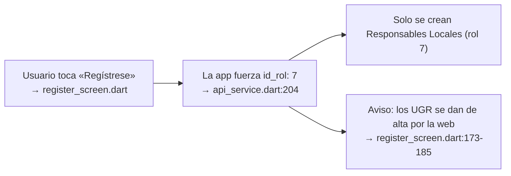
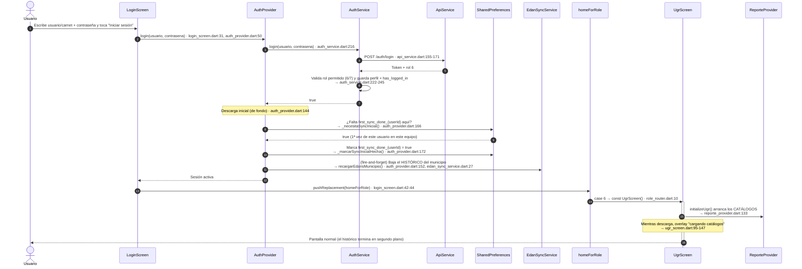
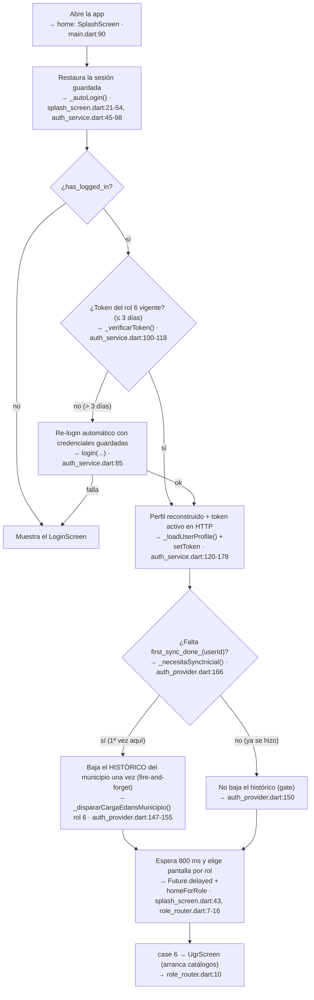
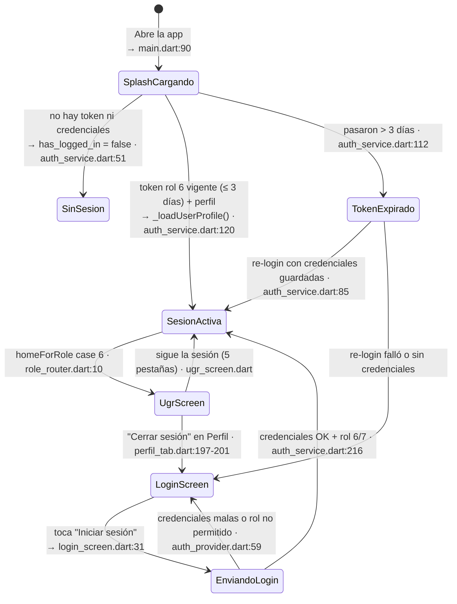
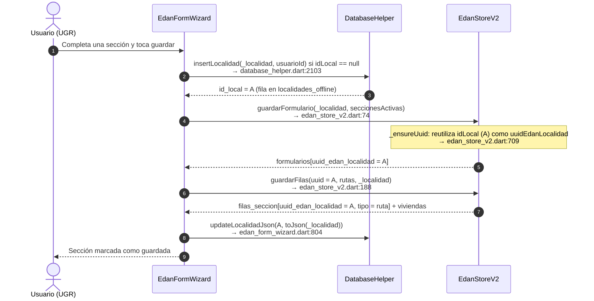
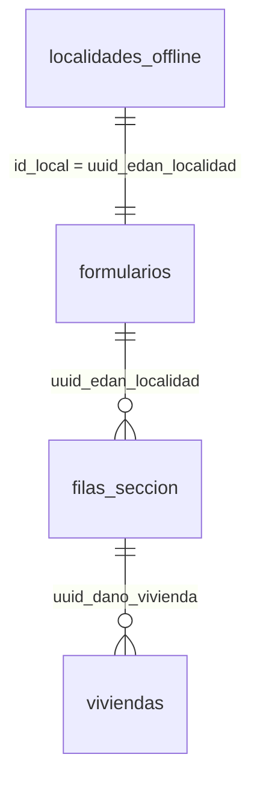

# Diagrama 02 — Rol 6 (UGR): Inicio de sesión y EDAN local

> **Proyecto:** Flutter `APP_REA/REA` (paquete `rea`, v1.1.4+15)
> **Alcance de este documento:** el **inicio de sesión** del rol 6 (UGR) —con las **descargas que ocurren después del login** (catálogos, estados EDAN e histórico de EDANs del municipio)— **más** la pestaña **Localidades**: crear/editar un EDAN local reutilizando el **wizard "Formulario EDAN"** y la **SQLite V2** (`formularios`/`filas_seccion`/`viviendas`), la **recuperación de los reportes propios** (con sus fotos) y la vista de las **fotos del municipio online**. También aclara que el **registro in-app NO existe** para este rol. Nada más.
> **Roles:** `6 = UGR`, `7 = RESP` (Responsable Local). Solo los roles 6 y 7 pueden entrar en la app (`app_roles.dart:15`). El rol 7 se documenta en `01_rol7_resp_sesion_y_registro.md`.

---

## Cómo leer estos diagramas (convención)

Cada nodo y cada mensaje de los diagramas está escrito con **dos cosas juntas**:

```
ACCIÓN (qué ocurre, en lenguaje normal)
→ FUNCIÓN (dónde ocurre en el código, para editar) · archivo.dart:línea
```

- La **primera línea** describe **qué está pasando**, en palabras normales.
- La **segunda línea** (empieza con `→`) dice **qué función/archivo** lo hace y su línea.

Así sabemos exactamente **qué ocurre** y **dónde tocar** el código. Para pedir un cambio, cita las dos partes.

---

## 0. Actores, endpoints y almacenamiento

| Actor / componente | Archivo | Qué es |
|---|---|---|
| `LoginScreen` | `lib/screens/login_screen.dart` | Pantalla de login (usuario/carnet + contraseña). Único camino para entrar como UGR. |
| `SplashScreen` | `lib/screens/splash_screen.dart` | Arranque: decide entre sesión guardada y Login (auto-login). |
| `AuthProvider` | `lib/providers/auth_provider.dart` | Envuelve `AuthService` y dispara la **descarga inicial** tras autenticar. |
| `AuthService` | `lib/services/auth_service.dart` | Login/auto-login/logout + persistencia. El token del rol 6 **expira a los 3 días**. |
| `ApiService` | `lib/services/api_service.dart` | Capa HTTP (`/auth/*` y `/edan/*`). |
| `ReporteProvider` | `lib/providers/reporte_provider.dart` | **Catálogos generales** (una vez por dispositivo) + estados EDAN. |
| `EdanSyncService` | `lib/services/edan_sync_service.dart` | Baja el **histórico de EDANs del municipio** (`recargarEdansMunicipio`). |
| `homeForRole()` | `lib/config/role_router.dart:7-16` | Switch de rol: 6→`UgrScreen`, 7→`RespScreen`. |

### Endpoints (`ApiConfig`: `edanEndpoint = /api/v2/edan`)

| Método + ruta | Uso | Llama |
|---|---|---|
| `POST /api/v2/auth/login` | Inicio de sesión (único camino del UGR) | `AuthService.login()` (`auth_service.dart:216`) |
| `GET /api/v2/edan/?order_by=id_edan&order=desc&skip&limit&id_municipio=` | **Histórico de EDANs del municipio** (descarga inicial) | `listarEdansPorMunicipio()` (`api_service.dart:726-746`) |
| `GET /api/v2/edan/estados` | Catálogo de **estados EDAN** | `getEstadosEdan()` (`api_service.dart:844`) |
| `GET /api/v2/edan/localidades-estado` | Catálogo de **estados de localidad** | `getLocalidadesEstado()` (`api_service.dart:1565`) |

> **No existe** `/auth/me` ni `/auth/refresh`: la vigencia del token se calcula **100 % localmente** en `_verificarToken()`. Para el rol 6 el token **expira a los 3 días** (el rol 7 es perpetuo).

### Almacenamiento de sesión y marcas de descarga

| Medio | Claves | Quién las escribe |
|---|---|---|
| `FlutterSecureStorage` | `auth_token`, `user_id`, `usuario`, `nombre`, `contrasena`, `id_rol`, `rol_name`, `last_login`, `permisos` | `AuthService.login()` (`auth_service.dart:228-245`) |
| `SharedPreferences` | `has_logged_in` (gate absoluto del auto-login) | `AuthService.login()` (`auth_service.dart:241-242`) |
| `SharedPreferences` | `first_sync_done_<userId>` — ¿ya corrió la **descarga inicial del histórico** de este usuario en **este** dispositivo? | `AuthProvider._marcarSyncInicialHecha()` (`auth_provider.dart:172-175`) |
| `SharedPreferences` | `catalogs_generales_sync` — ¿ya se bajaron los **catálogos generales** en **este** dispositivo? | `ReporteProvider._descargarCatalogosGenerales()` (`reporte_provider.dart:112-119`) |
| SQLite (`database_helper`) | `edans`, `catalogo_*`, geografía, `municipio_geojson` | Caché offline del histórico y catálogos |

---

## 1. Registro para el rol 6: **NO existe en la app**

El registro de la app es **exclusivo del rol 7** (el body de `/auth/register` fuerza `'id_rol': 7`, `api_service.dart:204`). Los **UGR se dan de alta por la plataforma web** (`register_screen.dart:173-185`).



> **Consecuencia para la descarga inicial:** como no existe un "registro limpio" para el UGR (que en el rol 7 deja la marca `first_sync_done_<userId>` puesta sin descargar), **el primer login de cualquier UGR siempre descarga** el histórico de su municipio. La marca solo se pone **después** de esa primera descarga.

---

## 2. Inicio de sesión (rol 6)

### 2.1 Desde el `LoginScreen` (primera vez del usuario en este equipo)



### 2.2 Reapertura de la app con sesión guardada (auto-login; el token del rol 6 expira a los 3 días)



### 2.3 Detalle de `_verificarToken` (rol 6 expira, rol 7 no)

| Rol | Veredicto |
|---|---|
| `7` (RESP) | **Siempre vigente** (no consulta red ni fecha) |
| `6` (UGR) | Vigente solo si `last_login` tiene **≤ 3 días** de antigüedad; si no, re-login silencioso con las credenciales guardadas o vuelve al `LoginScreen` |

---

## 3. Descargas tras el login (rol 6)

### 3.1 Qué se descarga

| Qué se descarga | **PRIMER LOGIN del usuario en este equipo** | **REAPERTURA** (ya sincronizado) |
|---|---|---|
| **Catálogos generales** (geografía + tipos de evento/localidad, cultivos, pecuario, grupos vulnerables/etarios, tipos de repositorio, geojson, estados de localidad, estados EDAN) | ✅ sí (una vez por dispositivo) | solo si el dispositivo aún no los bajó; si no, se leen de SQLite |
| **Histórico de EDANs del municipio** | ✅ sí, **una sola vez** | ❌ no (gate `first_sync_done_<userId>`) |
| **Reportes PROPIOS del UGR** (cabecera + secciones + **fotos** a local, vía motor V2) | ✅ sí, en cada login (recuperación; p.ej. celular nuevo) | ✅ sí, en cada login (idempotente) |
| **Localidades/fotos de OTROS** (resto del municipio) | ❌ no se bajan a local | ✅ se ven **online** al abrir cada reporte (`obtenerDocumento` + `Image.network`) |

### 3.2 Dónde ocurre cada descarga

| Qué se baja | Disparador | Función · Archivo:línea |
|---|---|---|
| **Catálogos generales** | `UgrScreen.initState` → `initializeUgr()` (`ugr_screen.dart:37-51`), que llama `initialize()` → `_descargarCatalogosGenerales()` | `ReporteProvider.fetchAndCacheCatalogs()` · `reporte_provider.dart:311` (gate por dispositivo `:112-119`; geografía `loadGeography()` `:145`) |
| **Estados EDAN** (general, ambos roles) | dentro de `fetchAndCacheCatalogs()` | `reporte_provider.dart:476` → `saveEstadosEdan` (`GET /edan/estados`) |
| **Estados de localidad** (general, ambos roles) | dentro de `fetchAndCacheCatalogs()` | `reporte_provider.dart:445` → `saveEstados` (`GET /edan/localidades-estado`) |
| **Histórico del municipio** | Primer login del usuario en el equipo, vía `_dispararCargaEdansMunicipio()` (`auth_provider.dart:147-155`) | `recargarEdansMunicipio()` — `listarEdansPorMunicipio` + insert/mark · `edan_sync_service.dart:27-71` |
| **Reportes propios (V2 + fotos)** | Primer login del usuario en el equipo, junto al histórico vía `_recuperarReportesPropiosV2()` (`auth_provider.dart`) | `EdanSyncEngineV2.sincronizar()` (pull → apply → push → descarga de fotos a `<appDocs>/edan_fotos`) · `edan_sync_engine_v2.dart` |

### 3.3 Los catálogos generales (una sola vez por dispositivo)

Los catálogos son **generales** (idénticos para los roles 6 y 7) y se bajan **una única vez por dispositivo**:

- `ReporteProvider.initialize()` (`reporte_provider.dart:78`) llama a `_descargarCatalogosGenerales()` (`:112`).
- `_descargarCatalogosGenerales()` consulta la marca `catalogs_generales_sync` (`reporte_provider.dart:21,114`): si ya existe, **no vuelve a descargar**; si no, ejecuta `fetchAndCacheCatalogs()` y, si todo salió bien (`_catalogsAllOk`), deja la marca puesta (`:116-118`).
- En reaperturas, los catálogos ya guardados se leen **de SQLite** (`loadCatalogsLocal()`, `reporte_provider.dart:200`).
- El botón **"Actualizar catálogos"** del Perfil (`perfil_tab.dart:352-390`) reutiliza **la misma** función `fetchAndCacheCatalogs()` (`perfil_tab.dart:374`) a mano, con **barra de progreso** mientras `rp.isDescargandoCatalogos` es `true`.

| Catálogo general | Endpoint | Se guarda en SQLite | Función · Línea |
|---|---|---|---|
| Departamentos (geografía) | `getDepartamentos()` | ✅ `saveDepartamentos` | `loadGeography()` · `reporte_provider.dart:145` |
| Tipos de evento | `GET /edan/tipo-evento` | ✅ `saveTiposEvento` | `fetchAndCacheCatalogs()` · `:311` (bloque 1) |
| Tipos de localidad | `getTipoLocalidad()` | ✅ `saveTiposLocalidad` | `fetchAndCacheCatalogs()` · `:311` (bloque 2) |
| Cultivos | `GET /shared/cultivos` | ✅ `saveCultivos` | `fetchAndCacheCatalogs()` · `:311` (bloque 3) |
| Grupos pecuarios | `GET /shared/pecuario` | ✅ `savePecuarioGrupos` | `fetchAndCacheCatalogs()` · `:311` (bloque 4) |
| Grupos vulnerables | `GET /edan/grupo-vulnerable` | ✅ `saveGruposVulnerables` (+fallback local) | `fetchAndCacheCatalogs()` · `:311` (bloque 5) |
| Grupos etarios | `GET /edan/grupo-etario` | ✅ `saveGruposEtarios` (+fallback local) | `fetchAndCacheCatalogs()` · `:311` (bloque 6) |
| Tipos de repositorio | `GET repositorio/tipos` | ✅ `saveTiposRepositorio` | `fetchAndCacheCatalogs()` · `:311` (bloque 7) |
| Geojson del municipio propio | `getMunicipioGeojson()` | ✅ `municipio_geojson` | `_downloadAndCacheMunicipioGeojson()` · `:502` |
| Estados de localidad | `GET /edan/localidades-estado` | ✅ `saveEstados` | `fetchAndCacheCatalogs()` · `:445` |
| Estados EDAN | `GET /edan/estados` | ✅ `saveEstadosEdan` | `fetchAndCacheCatalogs()` · `:476` |

> 🔗 **Función única:** `fetchAndCacheCatalogs()` es la **única** función de catálogos generales y baja **todos** los catálogos (se usen o no en cada rol). La usan `initialize()` (los dos roles), el wizard (`edan_page01`) y el botón del Perfil. Se eliminó la función parcial `fetchAndCacheCatalogsEdan()` que bajaba un subconjunto (y omitía `tiposLocalidad`).

> ⚠ **Categorías:** no existe endpoint conocido; `saveCategorias` (`database_helper.dart:1486`) sigue **sin llamadores** → `ReporteProvider.categorias` queda vacío. Los **estados** sí se llenan ahora.

### 3.4 Una sola vez y sin errores ni reintentos visibles

- **Histórico del municipio:** se dispara con `unawaited(...)` desde `AuthProvider` (sin `BuildContext`): corre en segundo plano y **no muestra resultado**. Los `catch` internos hacen `debugPrint` y terminan callados (`edan_sync_service.dart:66-67`). **No hay snackbars ni botones de "Reintentar".**
- **Catálogos:** cada catálogo va en su `try/catch`; si falla, no se muestra error y la marca `catalogs_generales_sync` **no** se deja puesta, de modo que el próximo arranque reintenta **en silencio**. Mientras descargan, la pantalla muestra solo un overlay de progreso (`CircularProgressIndicator` + texto de fase) **sin botón de reintento** (`ugr_screen.dart:95-147`).
- **Login:** el único error que ve el usuario es el de **credenciales/rol** (pantalla de login). La descarga posterior nunca bloquea ni interrumpe la navegación.

---

## 4. Máquina de estado de la sesión (login del rol 6)



---

## 5. Pestaña Localidades: EDAN local (wizard "Formulario EDAN" + SQLite V2)

Además del login, el UGR **crea** (FAB `+`) y **edita** EDAN locales reutilizando el **mismo widget** `EdanFormWizard` que usa el RESP, persistiendo en la **misma SQLite V2** (`formularios`, `filas_seccion`, `viviendas`). La rama de guardado se decide por la **inyección de `storeV2`**, no por el rol.

### 5.1 Componentes y puntos de entrada

| Componente / acción | Archivo:línea | Qué es |
|---|---|---|
| `UgrScreen` (FAB `+`) | `ugr_screen.dart:415` | Elige modo (wizard / asistente IA) y abre la ficha. |
| **Crear** | `edan_ia_elegir_creacion.dart:209` | Rama `wizard`, con `storeV2: EdanStoreV2.instance`. |
| **Editar** borrador propio | `ugr_localidades_tab.dart:901` | `_editarLocalidad()` con `storeV2` (solo si `esBorrador && esMia`). |
| Asistente con IA (no se toca) | `edan_ia_elegir_creacion.dart:215` | Guarda en SQLite **legacy** (`localidades_offline` + `seccion_*`). |
| `EdanStoreV2` | `edan_store_v2.dart` | `guardarFormulario` (`:74`) / `guardarFilas` (`:188`) / `cargarSecciones` (`:376`). |

### 5.2 Flujo de guardado (rama V2)



### 5.3 El vínculo `localidades_offline` ↔ `formularios`



**El vínculo es la clave de que la edición funcione** (misma lógica en UGR y RESP):

1. `EdanStoreV2._ensureUuid` (`:709`) **reutiliza el `idLocal`** de `localidades_offline` como `uuidEdanLocalidad`, de modo que `formularios.uuid_edan_localidad == localidades_offline.id_local`.
2. El wizard **sincroniza `datos_json`** de `localidades_offline` tras guardar (`edan_form_wizard.dart:804`).
3. `EdanStoreV2.cargarSecciones` (`:376`) usa `uuidEdanLocalidad ?? idLocal` como respaldo.
4. El wizard reabre con `uuid = uuidEdanLocalidad ?? idLocal` (`edan_form_wizard.dart:653`) y carga sus `filas_seccion`.

> Se cubre con `test/edan_v2/edan_vinculo_localidades_v2_test.dart`.

### 5.4 Sincronización y fotos (recuperación vs online)

| Caso | Qué pasa | Dónde |
|---|---|---|
| **Botón de sync** de la pestaña | `EdanSyncEngineV2().sincronizar()` (envía lo pendiente y **baja las fotos propias** a `<appDocs>/edan_fotos`) | `ugr_screen.dart` `_sincronizar()`; referencia `resp_screen.dart:342-422` |
| **Login** (dispositivo nuevo) | Dispara el mismo motor V2 en segundo plano → recupera **cabecera + secciones + fotos** de los reportes propios | `auth_provider.dart` `_recuperarReportesPropiosV2()` |
| **Lista offline** | Une `localidades_offline` (lo del wizard) **∪** `formularios` (lo recuperado) por `idLocal` | `ugr_localidades_tab.dart` `_cargarLocalidadesLocales()` |
| **Vista previa** | Si el reporte existe en `formularios` → secciones desde `filas_seccion` (V2); si no → legado (API/`seccion_*`) | `edan_preview_resp_screen.dart` `_cargarSecciones()` |
| **Reporte de OTRO** (online) | Pide el documento al servidor y muestra sus fotos con `Image.network` | `ugr_localidades_tab.dart` `_verDetalle()` → `ApiService.obtenerDocumento()` (`api_service.dart:1101`) |

> El UGR **no** baja a local los reportes de otros: los ve **online** al abrirlos. Los **propios** sí se bajan (cabecera + fotos), lo que permite verlos sin conexión y recuperarlos en un celular nuevo.

---

## 6. Observaciones

1. **El rol 6 no se registra en la app:** el registro fuerza `id_rol: 7` (`api_service.dart:204`); los UGR se dan de alta por la web (`register_screen.dart:173-185`). No existe el caso "registro limpio": **el primer login siempre descarga** el histórico.
2. **El token del rol 6 expira a los 3 días** (`_verificarToken`, `auth_service.dart:112-115`); tras ese lapso el arranque hace re-login silencioso o vuelve al `LoginScreen`.
3. **La "primera descarga" del UGR es el histórico de EDANs del municipio** (`recargarEdansMunicipio`, `edan_sync_service.dart:27-71`) **más** la recuperación de sus **reportes propios** (motor V2, con fotos) en ese mismo login.
4. **Una sola vez:** histórico por `first_sync_done_<userId>` (usuario+dispositivo) y catálogos por `catalogs_generales_sync` (dispositivo). La recuperación V2 de los reportes propios corre en **cada** login (idempotente). La descarga periódica al abrir la app queda como trabajo futuro *"Sincronización automática"*.
5. **Sin avisos de error ni reintento manual en las descargas de login** (ver §3.4); el **botón de sync** de la pestaña Localidades sí muestra un resultado (snackbar) y usa el motor V2 (§5.4).
6. **Una sola UI, dos almacenes:** el wizard "Formulario EDAN" es idéntico para los roles 6 y 7; la persistencia se decide por la **inyección de `storeV2`**, no por el rol. UGR (crear y editar) inyecta `EdanStoreV2.instance` → V2. El **asistente con IA no se toca** (sigue en legacy).
7. **Fotos UGR:** los reportes **propios** se bajan a local (cabecera + secciones + fotos) y se ven sin conexión; los de **otros** se piden y se ven **online**. La lista offline une `localidades_offline` ∪ `formularios` para no perder los recuperados (§5.4).
