# Diagrama 03 — El botón de guardar y la sincronización (¿automática o manual?)

> **Proyecto:** Flutter `APP_REA/REA` (paquete `rea`)
> **Alcance de este documento:** **solo** dos cosas: (1) qué hace realmente el **botón de guardar** del wizard "Formulario EDAN" y qué **no** hace; y (2) si la **sincronización** con el servidor es **automática, manual o ambas**. Nada más.
> **Roles:** `6 = UGR`, `7 = RESP` (Responsable Local). El wizard "Formulario EDAN" es **compartido** por ambos; se decide por **inyección de `storeV2`** (`edan_form_wizard.dart:52,109`).

---

## Cómo leer estos diagramas (convención)

Cada nodo y cada mensaje de los diagramas está escrito con **dos cosas juntas**:

```
ACCIÓN (qué ocurre, en lenguaje normal)
→ FUNCIÓN (dónde ocurre en el código, para editar) · archivo.dart:línea
```

- La **primera línea** describe **qué está pasando**, en palabras normales.
- La **segunda línea** (empieza con `→`) dice **qué función/archivo** lo hace y su línea.

---

## 0. Respuesta corta (TL;DR)

| Pregunta | Respuesta |
|---|---|
| ¿Qué guarda el **botón de guardar**? | **Solo local**: escribe en **SQLite** (V2 `formularios`/`filas_seccion`/`viviendas` o legacy `localidades_offline`/`seccion_*`). **No sube nada al servidor.** |
| ¿Cuándo se guarda? | Solo al **tocarlo explícitamente** (ícono de la AppBar), al elegir **"Guardar y salir"** o al **"Enviar"**. **Navegar con "Siguiente"/"Atrás" NO guarda.** |
| ¿La sincronización es automática o manual? | **Ambas.** Hay **botón manual** ("Sincronizar") y **disparadores automáticos** (recuperar la red, primer login en el dispositivo, apertura del dashboard). |
| ¿Guardar = enviar? | **No.** Guardar es local; el envío al servidor es un paso aparte (botón "Enviar" con conexión, o el motor de sync después). |
| ¿Se mantiene el **botón de sincronizar en la AppBar**? | **Sí, en ambos roles** (rol 6 y rol 7). Ver §7. |
| ¿Se **re-descargan los catálogos** en cada arranque? | **No.** Se leen de SQLite; solo se bajan la 1ª vez por dispositivo o al tocar "Actualizar catálogos". La **geografía sí se pide** en cada arranque. Ver §8. |

---

## 1. El botón de guardar: dónde está y qué hace

El wizard tiene **un** botón principal de guardado: el **ícono de disquete** en la AppBar.

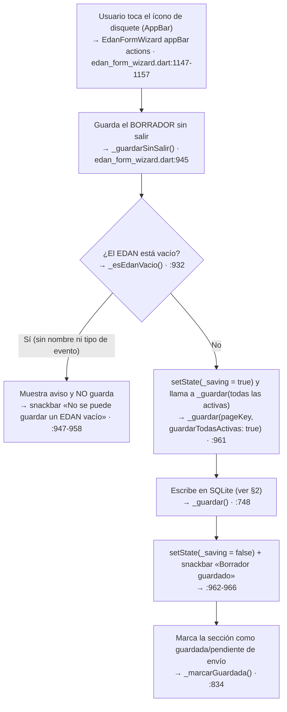

> **Detalle clave:** el botón de la AppBar llama con `guardarTodasActivas: true` (`:961`). Es decir, **persiste TODAS las secciones activadas por los flags de la página 1**, no solo la página visible. Así, si llenaste varias páginas y guardas desde una sola, las demás no se pierden (`:743-747`).

---

## 2. Qué escribe el guardado (dos caminos según `storeV2`)

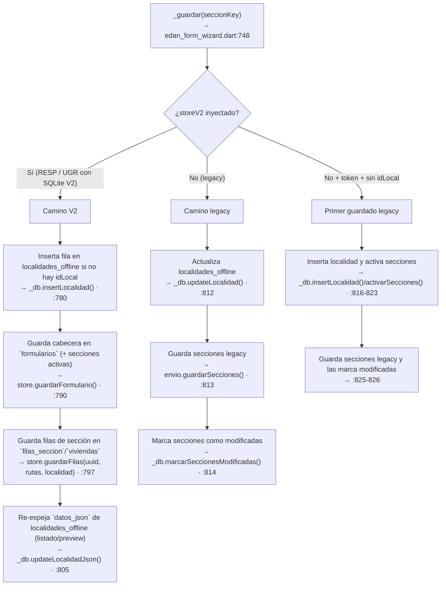

**En todos los casos el destino es la base local (SQLite). Ningún camino hace una llamada HTTP.**

---

## 3. Todas las formas de guardar (y la que NO guarda)

| Disparador | Qué hace | ¿Persiste? | Cita |
|---|---|---|---|
| **Ícono de disquete (AppBar)** | Guarda borrador sin salir | Sí (SQLite) | `edan_form_wizard.dart:1147-1157` |
| **"Guardar y salir"** (diálogo al salir con cambios) | `_guardarSinSalir(mostrarSnackBar:false)` y luego sale | Sí (SQLite) | `:996,1009-1011` |
| **"Enviar"** (última página, botón de envío) | Guarda **y** sube al servidor si hay conexión | Sí + red | `:1080-1133` |
| **"Guardar" dentro de un diálogo de fila** (p.ej. daños viales) | Agrega/edita **un registro en memoria** | **No** (solo memoria) | `edan_page09.dart:509-521` |
| **"Siguiente" / "Atrás"** (navegar entre páginas) | Solo cambia de página | **No** | `_next()` `:737-739` |
| **Cerrar/atrás del sistema con cambios** | Abre diálogo: "Cancelar" / "Salir sin guardar" / "Guardar y salir" | Depende de la opción | `_confirmarSalir()` `:970-1019` |

> ⚠ **No hay autoguardado por temporizador.** Si el usuario llena secciones, navega con "Siguiente" y cierra la app por el gesto del sistema **eligiendo "Salir sin guardar"**, esos datos no se persisten. La única red de seguridad es el diálogo de salida.

Diagrama del diálogo de salida (`_confirmarSalir`, `:970`):

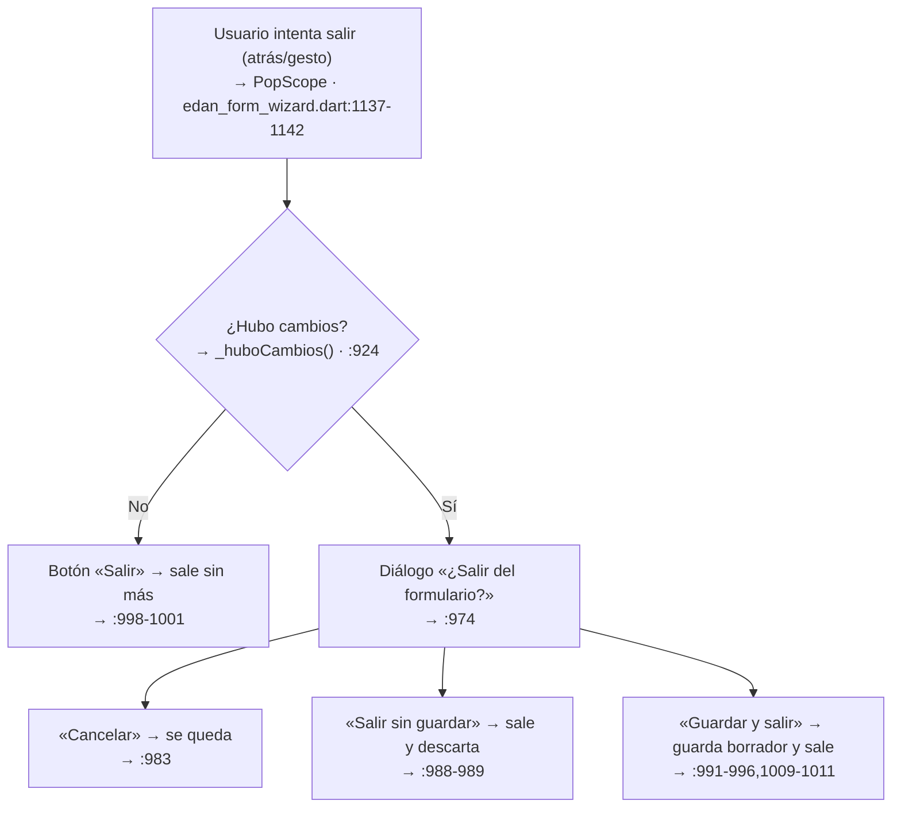

---

## 4. Guardar vs. Enviar (no son lo mismo)

- **Guardar** = escribir en la base local. Deja el reporte como **borrador pendiente**.
- **Enviar** = subir al servidor. Solo ocurre con el botón "Enviar" (cuando hay conexión) o, después, con el motor de sincronización.

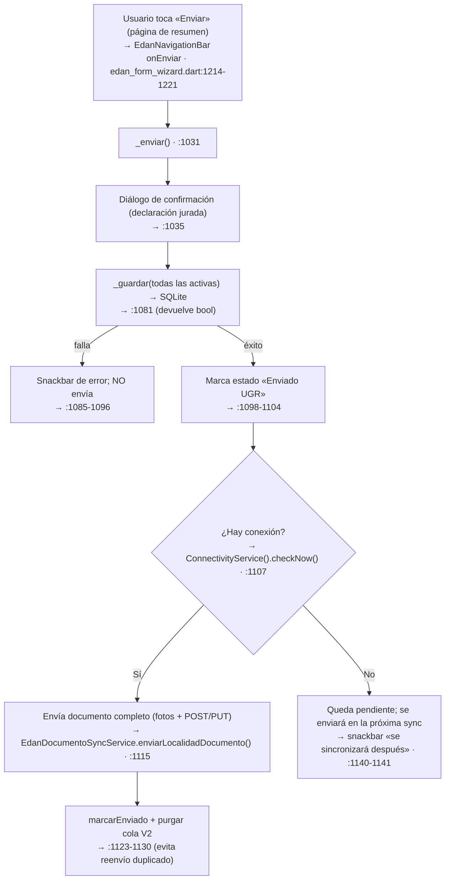

> El botón "Enviar" solo aparece cuando el reporte está en estado **borrador/rechazado** y el formulario está completo (`:1214-1221`).

---

## 5. ¿La sincronización es automática o manual? → **Ambas**

El motor es **`EdanSyncEngineV2.sincronizar()`**: empuja los cambios locales (formularios + fotos) y baja los cambios del servidor (pull). Se invoca desde **varios lugares**, unos manuales y otros automáticos.

### 5.1 Disparadores (tabla)

| Tipo | Disparador | Dónde | Cita |
|---|---|---|---|
| **Manual** | Botón "Sincronizar" (AppBar), UGR y RESP | `ugr_screen.dart:290-321` · `resp_screen.dart:296-325` |
| **Manual** | "Deslizar para refrescar" en el dashboard UGR | `ugr_dashboard_tab.dart:132-137,156-158` |
| **Automático** | Al **recuperar la red** (offline→online) | `ugr_screen.dart:72-77` · `resp_screen.dart:74-77` |
| **Automático** | Al **iniciar sesión** (primer login de este usuario en este dispositivo) | `auth_provider.dart:149-171` |
| **Automático** | Al **abrir el dashboard UGR** (`initState`, tras 2 s) | `ugr_dashboard_tab.dart:37-43,66-79` |
| **Automático** | Al **volver la app** a primer plano (`resumed`) recarga datos (no re-sincroniza) | `ugr_dashboard_tab.dart:45-51` |

### 5.2 El botón "Sincronizar" (manual) — **se mantiene en la AppBar de ambos roles**

El botón existe hoy y **se mantiene** en los dos roles: rol 6 `UgrScreen` (`ugr_screen.dart:161,290-321`) y rol 7 `RespScreen` (`resp_screen.dart:183,296-325`).

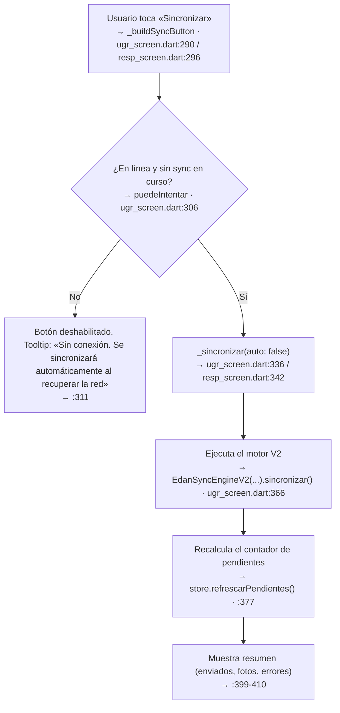

### 5.3 El disparador automático por conectividad

Cuando el teléfono **pasa de sin-conexión a con-conexión**, se lanza el sync automático (sin que el usuario haga nada).

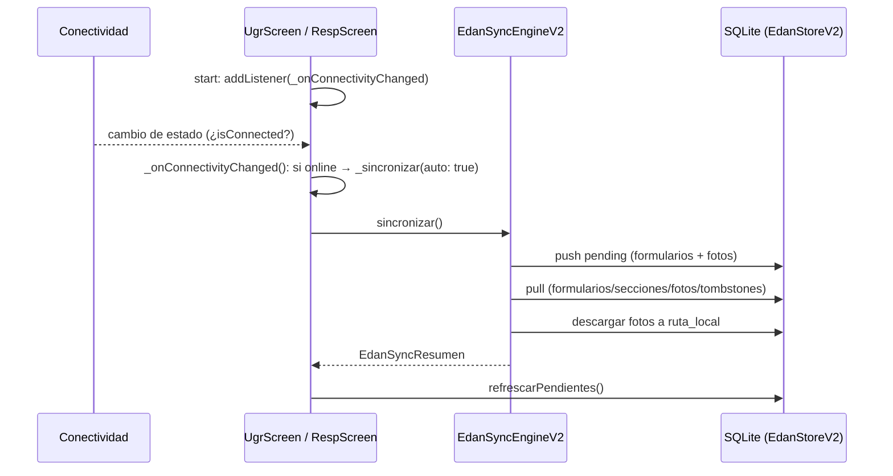

> El aviso de la interfaz coincide: *"Sin conexión. Se sincronizará automáticamente al recuperar la red"* (`ugr_screen.dart:311`, `resp_screen.dart:317`).

### 5.4 El disparador automático en el login (recuperación)

En el **primer login de este usuario en este dispositivo** se recuperan sus datos sin que lo pida (bandera `first_sync_done_<userId>` en `SharedPreferences`).

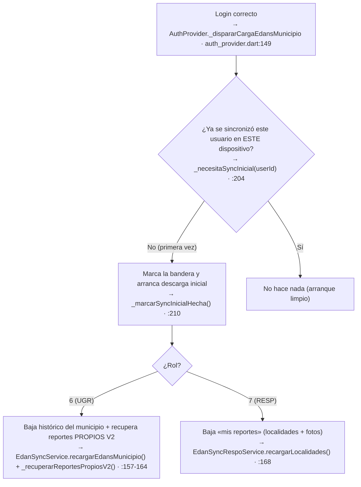

> `_recuperarReportesPropiosV2()` corre el **mismo motor V2** (fire-and-forget, no bloquea el login) para el caso *"perdió el celular y vuelve a entrar"*: el pull trae `formularios`/`filas_seccion`/`fotografias` y luego descarga los bytes de las fotos a `ruta_local` (`auth_provider.dart:179-201`).

### 5.5 Cómo se ve el "pendiente"

El número del badge del botón de sync es la suma de **cambios pendientes de subir** + **fotos pendientes**, calculado por el store local:

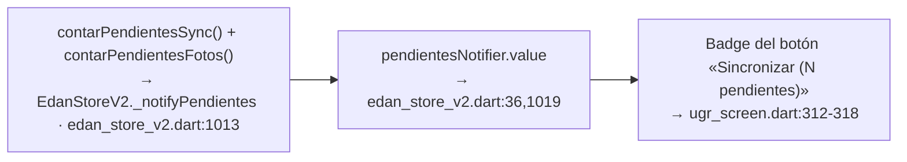

---

## 6. Flujo completo (guardar → pendiente → sincronizar)

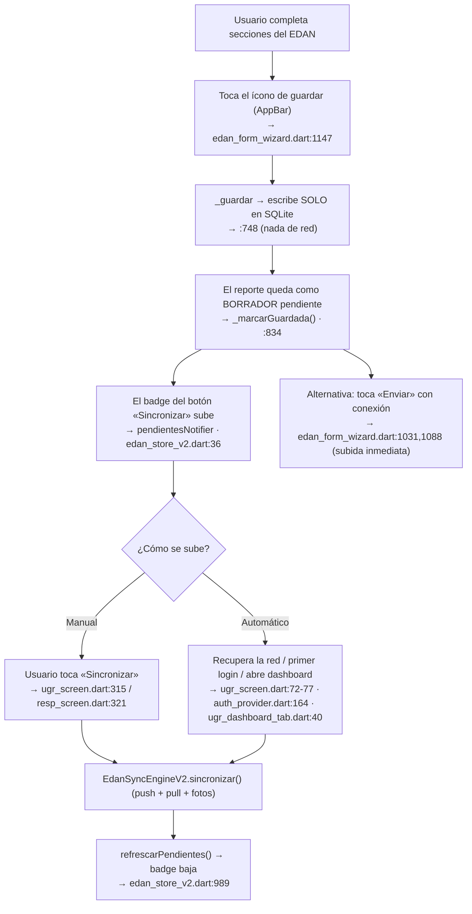

---

## 7. Cobertura por rol: **rol 6 (UGR) y rol 7 (RESP)**

> El mismo wizard "Formulario EDAN" y el mismo motor `EdanSyncEngineV2` sirven a **ambos** roles; lo que cambia es la **pantalla contenedora** y **qué reportes** se recuperan en el login.

| Aspecto | Rol 6 (UGR) | Rol 7 (RESP) |
|---|---|---|
| Pantalla contenedora | `UgrScreen` (`ugr_screen.dart`) | `RespScreen` (`resp_screen.dart`) |
| **Botón "Sincronizar" en la AppBar** | **Sí** (`ugr_screen.dart:161,290`) | **Sí** (`resp_screen.dart:183,296`) |
| Sync **automático al recuperar la red** | Sí (`ugr_screen.dart:72-77`) | Sí (`resp_screen.dart:74-77`) |
| Sync **automático al abrir el dashboard** | Sí (`ugr_dashboard_tab.dart:40`) | No aplica (sin dashboard) |
| **Pull-to-refresh** | Sí (`ugr_dashboard_tab.dart:132-137`) | No aplica |
| **Recuperación en el login** (primer login por dispositivo) | Reportes **propios** con motor V2 (`auth_provider.dart:164,179`) + histórico del municipio | "Mis reportes" vía `EdanSyncRespoService.recargarLocalidades` (`auth_provider.dart:168`) |
| Motor de subida/bajada | `EdanSyncEngineV2` | `EdanSyncEngineV2` (V2) + legacy `EdanSyncRespoService` (contadores/badge) |
| **Guardar** del wizard | Local, SQLite V2 | Local, SQLite V2 |

**Conclusión:** en **ambos roles** el guardado es local y la sincronización es **manual (botón en la AppBar) + automática (red/login/dashboard)**. El botón de la AppBar **no se quita** en ninguno.

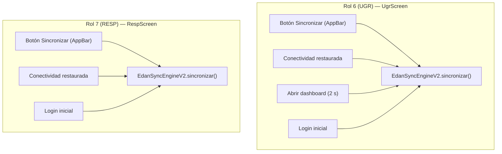

---

## 8. Catálogos al iniciar: ¿se vuelven a descargar o se pasa directo a sincronizar?

**Situación actual (código real).** Al abrir la app, cada rol inicializa los catálogos:

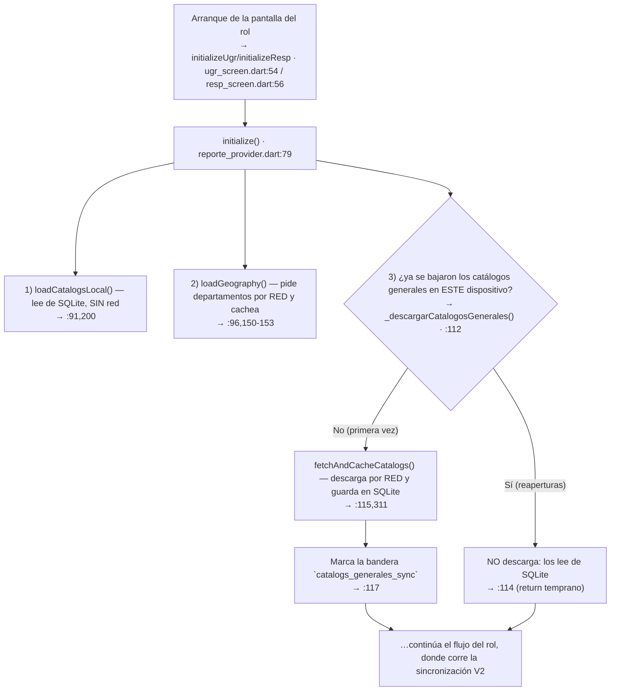

**Respuesta a "¿aún descargaremos los catálogos al iniciar?"**

- **Catálogos generales** (grupos etarios/vulnerables, tipos de evento, estados, etc.): **NO se re-descargan**. Se bajan **una sola vez por dispositivo** (bandera `catalogs_generales_sync`, `reporte_provider.dart:21,114`) y en las siguientes aperturas se **leen de SQLite**. El único punto de refresco es el botón **"Actualizar catálogos"** del Perfil (`perfil_tab.dart:374-387`).
- **Geografía** (departamentos): **SÍ se pide en cada arranque** (`loadGeography()` `reporte_provider.dart:96,150`), aunque se cachea en SQLite (`:152`). Provincias y municipios se bajan **bajo demanda** (`loadProvincias`/`loadMunicipios` `:162,180`).

**Recomendación (decisión a tomar).** Como los catálogos ya están locales, conviene **no volver a pedirlos por red al iniciar**:

1. Hacer `loadGeography()` **condicional**: si ya hay departamentos cacheados, **leerlos de SQLite** y **no** llamar al servidor (patrón *offline-first*), igual que ya hace `loadCatalogsLocal()`.
2. Dejar **"Actualizar catálogos"** (y opcionalmente "Actualizar geografía") como el **único** refresco manual.
3. Con eso, el arranque **salta directo a la sincronización** (pull de reportes/fotos) sin gastar datos ni bloquear la UI.

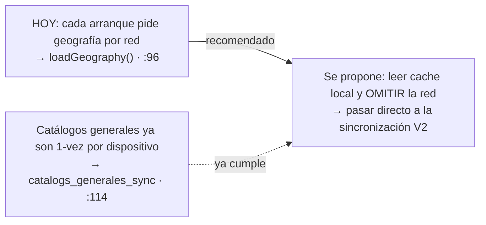

> ⚠ Es un **cambio de comportamiento** propuesto (no del código actual): hoy `loadGeography()` sí golpea la red en cada arranque. Si se aprueba, hay que tocar `reporte_provider.dart` (leer departamentos de SQLite cuando existan).

---

## 9. Observaciones y riesgos

1. ⚠ **Sin autoguardado.** No hay temporizador ni autosave al cambiar de página (`_next()` solo navega, `edan_form_wizard.dart:737-739`). Si el usuario cierra sin elegir "Guardar y salir", pierde lo no guardado.
2. ✅ **Guardar es netamente local.** Ninguna rama de `_guardar` (`:748-832`) hace HTTP; cumple la directiva "guardar es netamente en sqlite".
3. ✅ **La sincronización es híbrida (manual + automática).** Existe botón manual y también disparadores por conectividad, login inicial y apertura del dashboard.
4. ✅ **El botón "Enviar" es distinto del botón de guardar.** "Enviar" (`:1080-1133`) también **sube** (con conexión) usando el servicio legacy `EdanDocumentoSyncService`, mientras el guardado con `storeV2` usa el camino V2. Son dos mecanismos de subida que conviven; para que no suban lo mismo dos veces, el envío inmediato marca `formularios.estado_local = 'enviado'` y **purga la cola V2** de la localidad (`marcarEnviado` + `purgarColaDeFormulario`, `edan_store_v2.dart:145,959-984`).
5. ⚠ **Doble fuente de pendientes.** El badge del botón de sync usa `EdanStoreV2` (V2), pero sobreviven contadores legacy (`EdanSyncRespoService.recargarPendientes()`, `resp_screen.dart:88`). Conviene no mezclarlos al mostrar "pendientes".
6. ℹ️ **"resumed" no re-sincroniza.** Al volver la app a primer plano solo se **recargan datos de lectura** (`ugr_dashboard_tab.dart:45-51`), no se re-ejecuta el motor.
7. ✅ **(Corregido) El botón "Sincronizar" ya no queda deshabilitado con red estable.** Ver §10.
8. ⚠ **Fotos de una sección que nunca se confirma quedan pendientes para siempre.** El gate de subida exige que la `filas_seccion` dueña esté `confirmado` (§11). Si esa sección falla de forma persistente (p.ej. 4xx), sus fotos nunca suben y solo se ven como "fotos pendientes" en el resumen del sync.
9. ✅ **(Corregido) El guardado ya no reporta éxito si la escritura falla.** `_guardar` devuelve `bool` (`edan_form_wizard.dart:748`) y sus llamadores `_guardarSinSalir` (`:963`) y `_enviar` (`:1081`) muestran un error y abortan en vez de decir "Borrador guardado"/"Formulario enviado".

---

## 10. Cuándo se habilita el botón "Sincronizar" (conectividad)

El botón se habilita solo si `online && chequeoCompletado && !sincronizando`. Antes de que se resuelva el **primer** chequeo de red queda apagado con tooltip **"Verificando conexión..."**; sin red queda apagado con tooltip **"Sin conexión. Se sincronizará automáticamente al recuperar la red."** (`resp_screen.dart:310-320`, `ugr_screen.dart:305-315`).

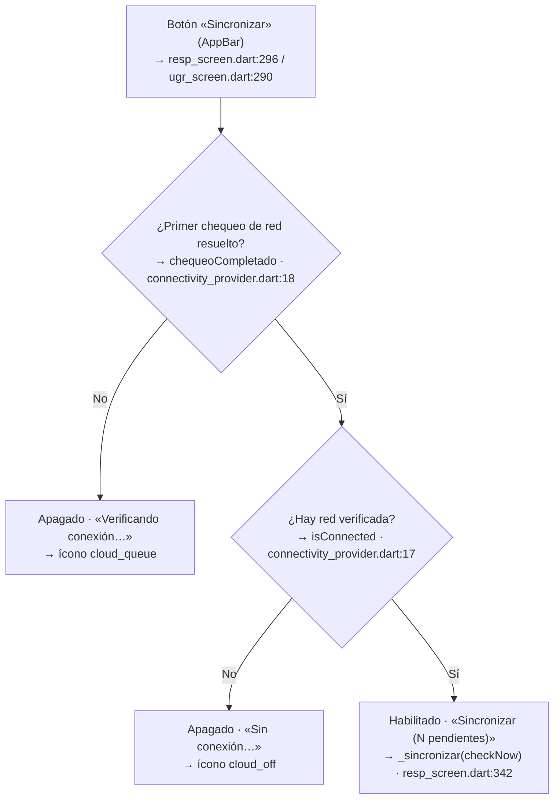

### 10.1 El deadlock que estaba corregido (bug real)

**Síntoma:** en **rol 7** (y también rol 6) el chip de la AppBar decía *"En línea"* pero el botón estaba **deshabilitado**, a veces indefinidamente.

**Causa raíz:**

1. `ConnectivityService` arranca con `_isConnected = true` optimista y `_chequeoCompletado = false` (`connectivity_service.dart:30-31`).
2. En el primer chequeo, con red estable el resultado es `true`; el servicio usaba `_aplicarEstado(true)`, que **no emite** porque coincide con el valor optimista (`connectivity_service.dart:83-87`).
3. El `ConnectivityProvider` solo aprendía el estado por el **stream** o copiándolo en `initialize()` (`connectivity_provider.dart`). Como en `main.dart` ambos se inicializaban en paralelo, copiaba `chequeoCompletado = false` y nunca recibía la transición.
4. Rol 7 monta `RespScreen` **directo** (`role_router.dart:11-12`); no pasa por `HomeWithDrawer`, que era el único que re-llamaba `initialize()` (`home_with_drawer.dart:33`). Sin corte de red, el botón no se rehabilitaba nunca.

**Corrección aplicada:**

- `ConnectivityService._consultarYActualizar()` ahora **siempre emite** el primer resultado (`_connectionController.add(connected)`), sin el atajo de solo-en-cambio.
- `ConnectivityService.initialize()` es **idempotente y esperable** (guarda su `Future`), y `ConnectivityProvider.initialize()` **espera** ese `Future` antes de leer el estado.
- `main.dart:49-52` arranca el servicio y deja que el provider espere el mismo chequeo.

Cubierto por `test/connectivity/connectivity_provider_test.dart`.

---

## 11. Ciclo de vida de las fotos (varias secciones por formulario)

Un formulario EDAN **puede tener varias fotos** y cada foto pertenece a **una sección** (o a una **vivienda** del detalle 1:N). Cada foto es una fila independiente: `fotografias` (metadatos + `ruta_local`/`ruta_servidor`) y `cola_fotos` (subida), con su propio `uuid_fotografia` y un `uuid_registro` que apunta a la sección/vivienda dueña. Por eso **muchas fotos pueden compartir la misma sección** y **cada sección puede tener la suya**.

| Momento | Qué ocurre | Dónde |
|---|---|---|
| **Captura** | Se registra la foto (`registrarFoto`) y se **encola** (`encolarFoto`) con `tipo_entidad` = `filas_seccion`/`vivienda` y `uuid_registro` = sección | `edan_boton_sacar_foto.dart:236-237` · `edan_store_v2.dart:827-845` |
| **Subida (push)** | El motor sube las fotos **solo** cuando su dueña está `estado_sync = 'confirmado'` | `edan_sync_engine_v2.dart:729-813` |
| **Orden en una corrida** | `formulario` → `filas_seccion` → `vivienda` → **fotos**. Las secciones se confirman **antes** que las fotos, así que una sección nueva y sus fotos suben en **el mismo** sync | `_pushSync :456-471` · `sincronizar :88-91` |
| **Tope por corrida** | `LIMIT 50` fotos por corrida; el resto espera a la siguiente | `_pushFotos :758` |
| **Bajada (pull, dispositivo nuevo)** | El pull registra metadatos (`ruta_servidor`) y luego se **descargan los bytes** a `edan_fotos/<uuid>.jpg` si se inyectó `dirFotos` | `_aplicarFotoPull :312-353` · `_descargarFotosPendientes :361-405` |
| **Borrado** | Se propaga al servidor el borrado lógico de fotos ya subidas | `_pushBorradosFotos :822-` |

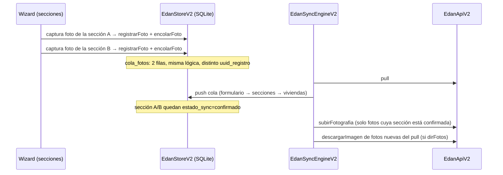

> **Regla de oro:** *primero la sección, después sus fotos.* Si una sección no llega a `confirmado`, sus fotos quedan `pendiente` y se reintentan en cada sync (riesgo #8 en §9).

---

## 12. Máquina de estados de la cola (qué se reintenta y qué no)

El motor **no reenvía todo en cada sync**: consulta la columna `estado` de las **colas** y procesa **solo** las filas en `pendiente`/`subiendo` cuyo `fecha_proximo_intento` ya venció. Hay **dos** tablas con esa columna:

- **`cola_sincronizacion`** — formularios, filas de sección y viviendas (`tabla` = `formulario`/`filas_seccion`/`vivienda`).
- **`cola_fotos`** — fotos (subida; gate extra: su sección/vivienda dueña debe estar `estado_sync = 'confirmado'`).

```sql
-- _pushSync · edan_sync_engine_v2.dart:458-471
WHERE estado IN ('pendiente','subiendo')
  AND (fecha_proximo_intento IS NULL OR fecha_proximo_intento <= :now)
ORDER BY (formulario → filas_seccion → vivienda), fecha_registro ASC
LIMIT 200

-- _pushFotos · edan_sync_engine_v2.dart:737-759 (mismo filtro + gate de la dueña)
WHERE f.estado IN ('pendiente','subiendo')
  AND (f.fecha_proximo_intento IS NULL OR f.fecha_proximo_intento <= :now)
  AND <dueña confirmada>
LIMIT 50
```

| Estado | Significado | ¿Se reintenta? | Cita |
|---|---|---|---|
| `pendiente` | Recién encolado o falló y espera el backoff | **Sí** (cuando vence `fecha_proximo_intento`) | `edan_store_v2.dart:800-824` · `edan_sync_engine_v2.dart:504-523` |
| `subiendo` | Marcado al iniciar el intento | Sí (si la app murió a mitad, se reprocesa) | `edan_sync_engine_v2.dart:480-481` |
| _(borrada)_ | Subida OK | No (se purga la fila) | `edan_sync_engine_v2.dart:486-489` |
| `conflicto` | 409: hay una versión más nueva en el servidor | **No** (se estaciona con `servidor_snapshot`) | `edan_sync_engine_v2.dart:491-503` |

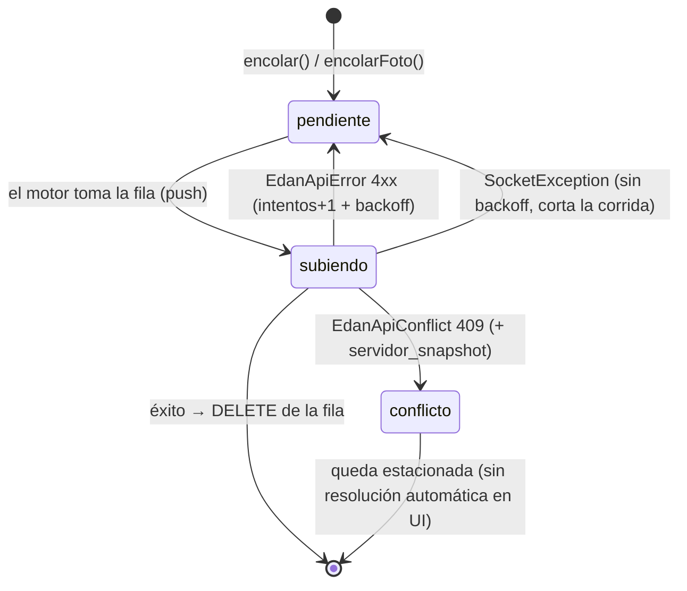

**Backoff exponencial** (`_backoff`, `edan_sync_engine_v2.dart:864-869`): `2 · 2^intentos` segundos, con **tope de 1 hora.** Un 4xx reintenta según esa espera; una caída de red (`SocketException`) deja la fila en `pendiente` **sin** backoff y **corta** la corrida para no encadenar fallos.

> **Nota de contrato:** `conflicto` **no** se reintenta solo; solo se cuenta (`conflictosNotifier`, `edan_store_v2.dart:37,972,1020`). Además, `_esLocalidadSucia` (`edan_sync_engine_v2.dart:439`) usa estos mismos estados para **no pisar por pull** una fila que tiene una subida pendiente.

> **Referencia legacy vs. V2:** los MD previos (`docs/DOCUMENTO_V2_SYNC.md:648,665`) describen el flujo **legacy** con flags `pendiente`/`subida` en `localidad`/`foto_pendiente`. El `estado` de `cola_sincronizacion`/`cola_fotos` es el mecanismo **V2** que reemplaza a esos flags para decidir qué se reintenta.

---


