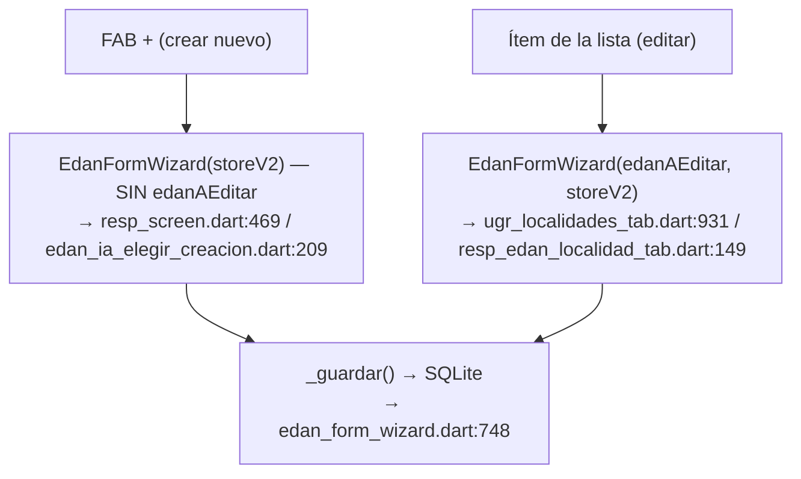
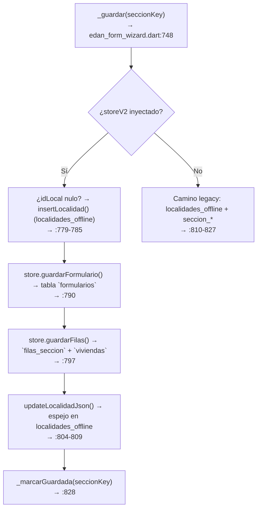
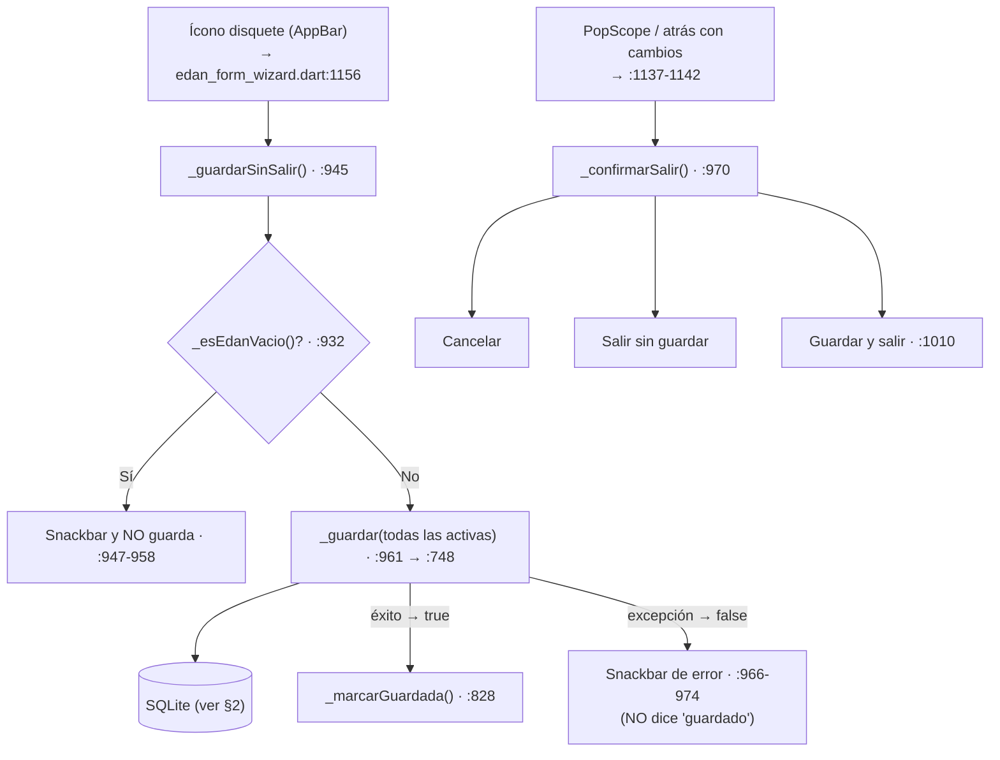
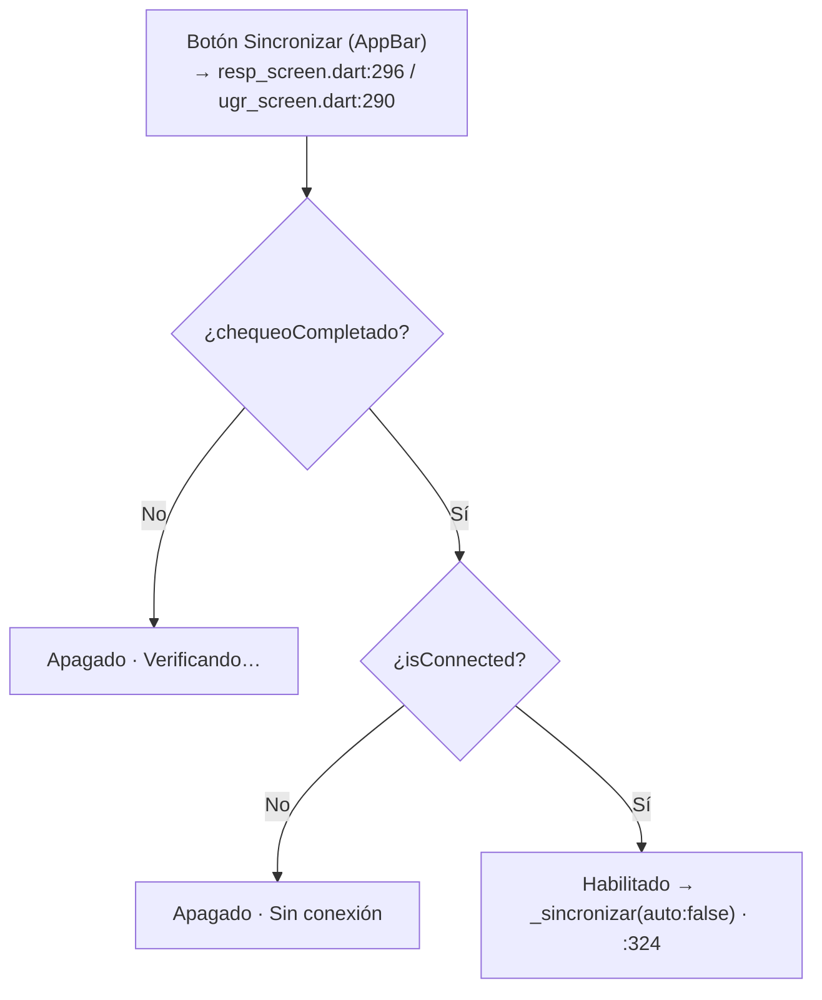
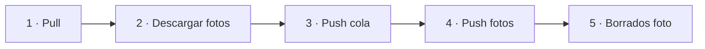
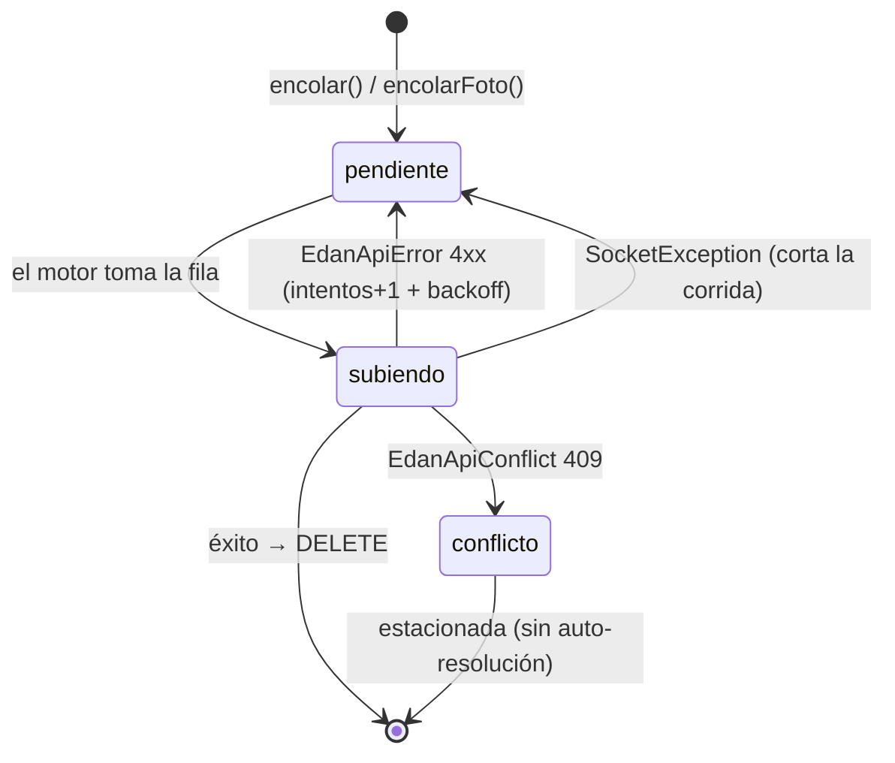
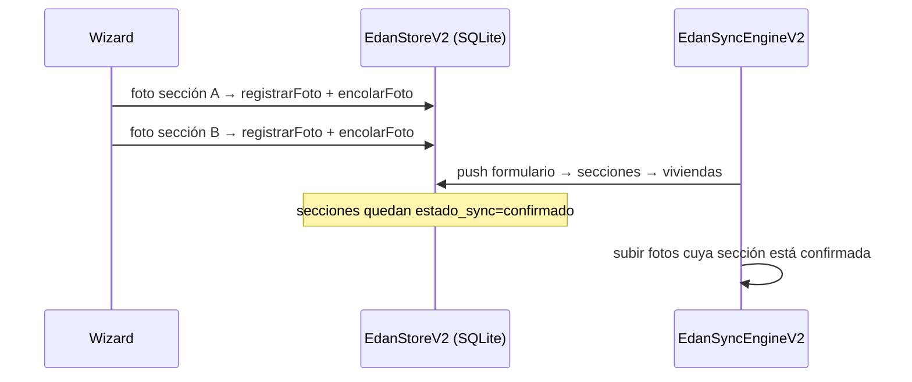
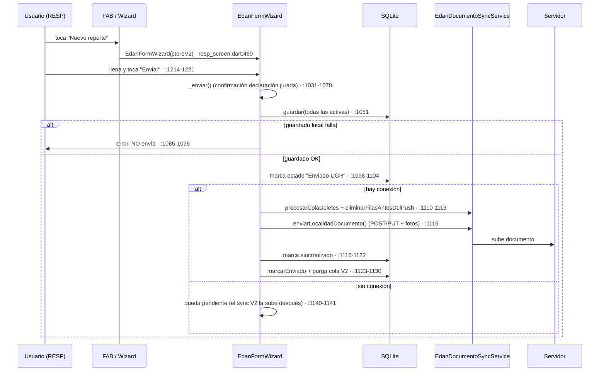

# Diagrama 04 — Wizard "Formulario EDAN": SQLite, guardar y sincronizar (máquina de estados)

> **Proyecto:** Flutter `APP_REA/REA` (paquete `rea`).
> **Alcance:** el wizard **"Formulario EDAN"** y su relación con **SQLite**: cómo se **crea** y se **edita**, qué hace el **botón de guardar**, y cómo funciona el **botón de sincronizar** con la **máquina de estados de la cola**. Diagramas y tablas.
> **Roles:** `6 = UGR`, `7 = RESP`. El wizard es **compartido**; el camino se elige por **inyección de `storeV2`** (`edan_form_wizard.dart:52,54,109`).
> **Complementa a:** `03_boton_guardar_y_sincronizacion.md` (§5–§12).

---

## 0. TL;DR (tabla)

| Pregunta | Respuesta | Cita |
|---|---|---|
| ¿Qué hace **guardar**? | Escribe **solo en SQLite**. Ningún camino hace HTTP. | `edan_form_wizard.dart:748-832` |
| ¿Cuándo se guarda? | Al **ícono de disquete**, "Guardar y salir" o "Enviar". **Navegar NO guarda.** | `:1156` · `:1010` · `:1069` |
| ¿**Crear nuevo**? | FAB `+` → wizard (o IA). Sin `edanAEditar`. | `ugr_screen.dart:461-476` · `resp_screen.dart:466-472` |
| ¿**Editar**? | Desde la lista → wizard con `edanAEditar: Edan.desdeLocalidad(loc)` + `storeV2`. | `ugr_localidades_tab.dart:928-941` · `resp_edan_localidad_tab.dart:146-159` |
| ¿**Enviar**? | "Enviar" guarda **y además sube** (si hay red) con `EdanDocumentoSyncService`. | `:1031-1113` |
| ¿**Sincronizar** (botón AppBar)? | Motor **V2** (`EdanSyncEngineV2`); reintenta **solo** las filas `pendiente`/`subiendo`. | `:73-95` · `:456-523` |
| ¿Dónde vive la cola? | Tablas `cola_sincronizacion` y `cola_fotos` (columna `estado`). | `database_helper.dart:400-431` |

---

## 1. Entradas al wizard: crear nuevo vs. editar (tabla)

| Caso | Rol | Disparador | ¿Pasa `edanAEditar`? | Cita |
|---|---|---|---|---|
| **Crear nuevo** | 6 (UGR) | FAB `+` "Crear EDAN localidad" → `pedirModoCreacionEdan` → `abrirCreacionEdan` (elige wizard o IA) | **No** | `ugr_screen.dart:461-476` · `edan_ia_elegir_creacion.dart:201-213` |
| **Crear nuevo** | 7 (RESP) | FAB "Nuevo reporte" → `_abrirWizardDirecto()` | **No** | `resp_screen.dart:455-472` |
| **Editar** | 6 (UGR) | Ítem de la lista → `_editarLocalidad` | **Sí** | `ugr_localidades_tab.dart:928-941` |
| **Editar** | 7 (RESP) | Ítem de lista/dashboard → `_editarLocalidad` | **Sí** | `resp_edan_localidad_tab.dart:146-159` · `resp_dashboard_tab.dart:161` |

> En edición, `Edan.desdeLocalidad(loc)` rehidrata el modelo y `guardarFormulario` hace **upsert por `uuid_edan_localidad`** (`ConflictAlgorithm.replace`), así que **actualiza la misma fila** (`edan_store_v2.dart:127-130`).

---

## 2. Wizard → SQLite: tablas V2 (tabla)

Todas del schema **v30** (`database_helper.dart:312-431`). Se usan cuando hay `storeV2` (RESP / UGR V2).

| Tabla | PK | Para qué | Cita |
|---|---|---|---|
| `formularios` | `uuid_edan_localidad` | Cabecera del EDAN + `datos_json` + `secciones_activas_json` + `estado_local` | `:313-346` |
| `filas_seccion` | `uuid_registro` | Filas de sección (1:N), `datos_json`, `estado_sync` | `:348-362` |
| `viviendas` | `uuid_registro` | Detalle 1:N de daños de vivienda | `:364-379` |
| `fotografias` | `uuid_fotografia` | Metadatos + `ruta_local`/`ruta_servidor`, `borrado_logico` | `:381-397` |
| `cola_sincronizacion` | `id` | Cola de subida (formulario/secciones/viviendas) con `estado` | `:399-417` |
| `cola_fotos` | `uuid_fotografia` | Cola de subida de fotos con `estado` | `:419-431` |
| `localidades_offline` | `id_local` | Espejo de listado (`datos_json`) — compartido con el flujo legacy | `edan_form_wizard.dart:780,805` |

---

## 3. Botón GUARDAR: disparadores (tabla + diagrama)

| Disparador | Qué hace | ¿Persiste? | Cita |
|---|---|---|---|
| **Ícono de disquete (AppBar)** | `_guardarSinSalir()` → `_guardar(guardarTodasActivas:true)` | Sí (SQLite) | `:1156` · `:945` · `:961` |
| **"Guardar y salir"** | `_guardarSinSalir(mostrarSnackBar:false)` y sale | Sí | `:1010` |
| **"Enviar"** | Guarda **y** sube si hay red | Sí + red | `:1080-1133` |
| **"Guardar" de un diálogo de fila** | Registro **en memoria** | **No** | `edan_page09.dart:509-521` |
| **"Siguiente" / "Atrás"** | Solo navega | **No** | `_next :737` |
| **Guardar con EDAN vacío** | Avisa y **no** guarda | — | `_esEdanVacio :932` · `:947-958` |

> Desde el arreglo, `_guardar` devuelve `bool` (`:748`) y sus llamadores (`_guardarSinSalir :961`, `_enviar :1081`) **abortan y muestran error** si la escritura a SQLite falla, en lugar de reportar "Borrador guardado".

---

## 4. Qué escribe cada camino (tabla)

| Camino | Condición | Destino local | Cita |
|---|---|---|---|
| **V2** | `storeV2 != null` | `formularios` + `filas_seccion`/`viviendas` (+ espejo `localidades_offline.datos_json`) | `:776-809` |
| **Legacy (edición)** | sin `storeV2` y `idLocal != null` | `localidades_offline` + `seccion_*` (marca `secciones modificadas`) | `:810-814` |
| **Legacy (primer guardado)** | sin `storeV2`, con token, sin `idLocal` | inserta localidad + activa secciones + `seccion_*` | `:815-826` |

> **Directiva cumplida:** "guardar es netamente en sqlite" — las tres ramas terminan en SQLite, **nunca** en HTTP.

---

## 5. Botón SINCRONIZAR: cuándo se habilita (tabla + diagrama)

`puedeIntentar = online && chequeoCompletado && !sincronizando` (`resp_screen.dart:310-313`, `ugr_screen.dart:304-307`).

| Estado | `online` | `chequeoCompletado` | Botón | Tooltip |
|---|---|---|---|---|
| Verificando | — | `false` | Apagado (`cloud_queue`) | "Verificando conexión..." |
| Sin red | `false` | `true` | Apagado (`cloud_off`) | "Sin conexión. Se sincronizará automáticamente al recuperar la red." |
| En red | `true` | `true` | **Habilitado** (`cloud_upload`) | "Sincronizar" / "Sincronizar (N pendientes)" |
| Sincronizando | — | — | Deshabilitado (spinner) | "Sincronizando..." |

> El `ConnectivityProvider.initialize()` **espera** el primer chequeo y el servicio **siempre emite** el primer resultado (corrige el botón que quedaba apagado con red estable; ver doc 03 §10).

---

## 6. Fases del motor de sync (tabla + diagrama)

`EdanSyncEngineV2.sincronizar()` (`edan_sync_engine_v2.dart:73-134`), en orden:

| # | Fase | Qué hace | Cita |
|---|---|---|---|
| 1 | **Pull** | Baja `formularios`/`secciones`/`viviendas`/`fotos`/`tombstones` + `watermark` | `:79` · `_aplicarPull :143` |
| 2 | **Descarga de fotos** | Baja bytes de fotos del pull a `edan_fotos/<uuid>.jpg` (si hay `dirFotos`) | `:87` · `:361-405` |
| 3 | **Push (cola)** | Envía `cola_sincronizacion` en orden `formulario → filas_seccion → vivienda` | `:89` · `:456-471` |
| 4 | **Fotos (push)** | Sube `cola_fotos` solo si la dueña está `confirmado` | `:91` · `:729-759` |
| 5 | **Borrados de foto** | Propaga borrado lógico de fotos ya subidas | `:95` · `:822` |

---

## 7. Máquina de estados de la cola (tabla + diagrama)

El motor filtra por `estado` y `fecha_proximo_intento` (`edan_sync_engine_v2.dart:460-471`, `:740-759`).

| Estado | Significado | ¿Reintenta? | Cita |
|---|---|---|---|
| `pendiente` | Encolado o falló; espera `fecha_proximo_intento` | **Sí** | `:504-523` |
| `subiendo` | En intento (si la app murió, se reprocesa) | Sí | `:480-481` |
| _(borrada)_ | Subida OK → se purga la fila | No | `:486-489` |
| `conflicto` | 409: versión más nueva en servidor (+ `servidor_snapshot`) | **No** (estacionada) | `:491-503` |

**Backoff** (`_backoff :864-869`): `2 · 2^intentos` s, **tope 1 h**. `SocketException` → `pendiente` sin backoff y **corta** la corrida.

---

## 8. Fotos multi-sección (tabla + diagrama)

| Momento | Qué ocurre | Cita |
|---|---|---|
| **Captura** | `registrarFoto` + `encolarFoto` (`tipo_entidad`, `uuid_registro`) | `edan_boton_sacar_foto.dart:236-237` · `edan_store_v2.dart:827-845` |
| **Gate de subida** | Solo si la `filas_seccion`/vivienda dueña está `estado_sync='confirmado'` | `edan_sync_engine_v2.dart:742-756` |
| **Varias por sección** | Cada foto tiene su `uuid_fotografia`; comparten `uuid_registro` | `database_helper.dart:382-397` |
| **Bajada** | Pull de metadatos + `_descargarFotosPendientes` | `:312-353` · `:361-405` |

---

## 9. Crear nuevo y ENVIAR (diagrama + tabla)

| Acción | Destino | ¿Sube al servidor? | Motor | Cita |
|---|---|---|---|---|
| **Guardar** | SQLite | **No** | — | `:748-832` |
| **Enviar** | SQLite + servidor | **Sí** (si hay red) | **`EdanDocumentoSyncService`** (todo-en-uno legacy) | `:1080-1133` |
| **Sincronizar** (botón) | SQLite + servidor | **Sí** | **`EdanSyncEngineV2`** (cola + pull) | `edan_sync_engine_v2.dart:73-134` |

> **Dos mecanismos de subida conviven:** "Enviar" usa el servicio legacy (`enviarLocalidadDocumento`); el botón "Sincronizar" usa el motor V2 por colas. El botón "Enviar" solo aparece en estados **borrador/rechazado** y con el formulario completo (`:1214-1221`).
>
> **Sin doble subida (corregido):** tras un envío inmediato exitoso, `_enviar` marca `formularios.estado_local = 'enviado'` y **purga la cola V2** de esa localidad (`marcarEnviado` + `purgarColaDeFormulario`, `edan_store_v2.dart:145,959-984`) para que el motor no reenvíe lo mismo. Además, si el guardado local falla, `_enviar`/`_guardarSinSalir` **abortan y avisan con error** en vez de reportar éxito (`_guardar` devuelve `bool`).
