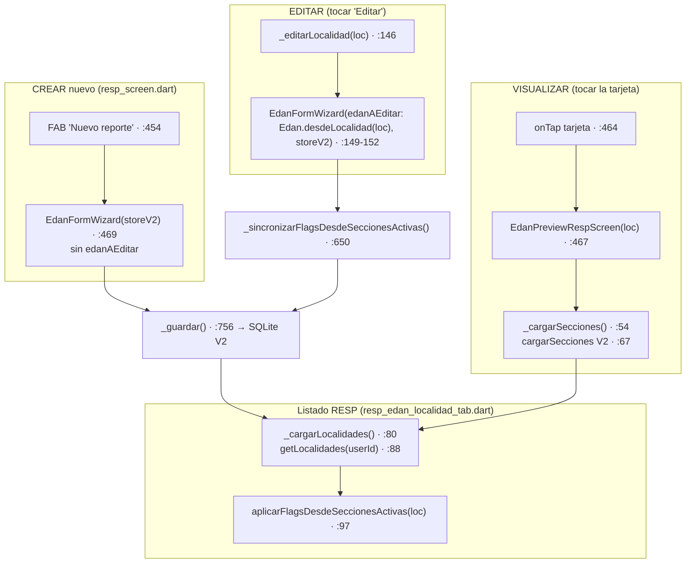
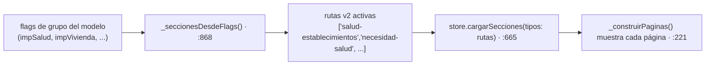
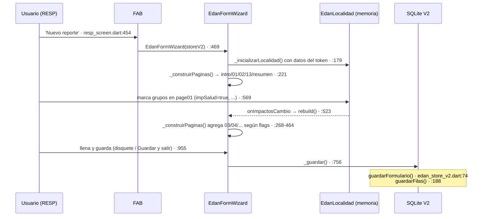
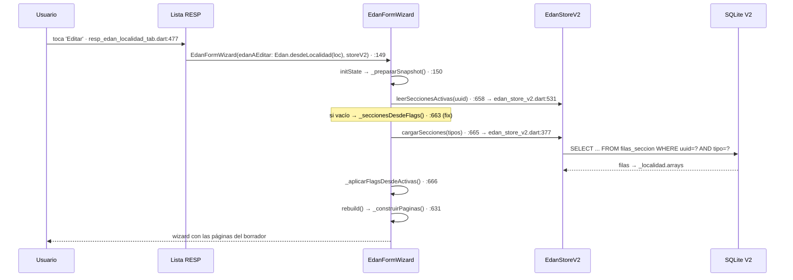
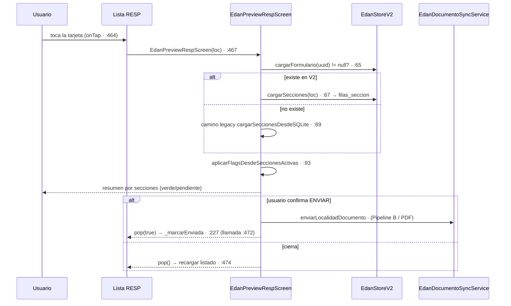
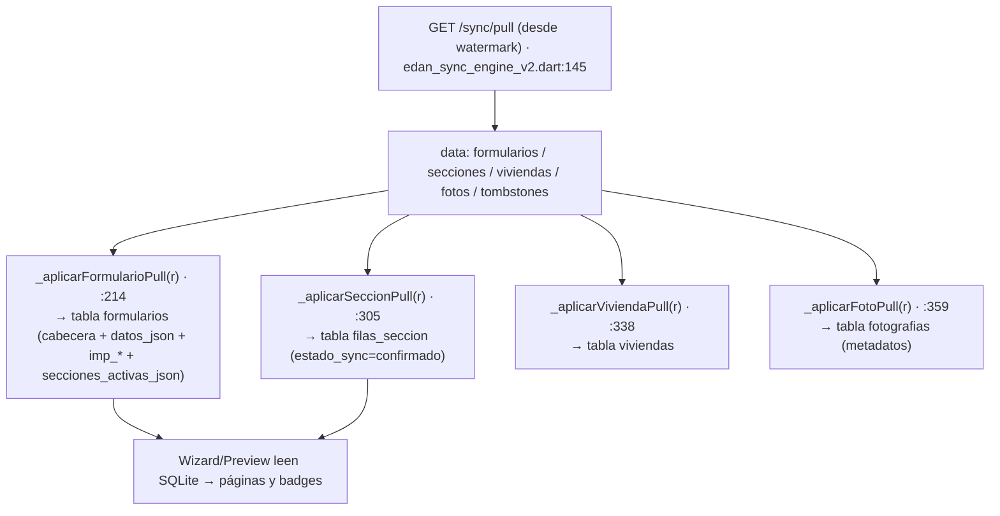
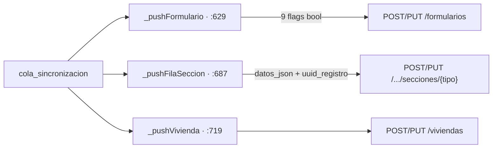

# Diagrama 05 — Wizard EDAN: cómo se muestran y recogen los datos (crear · editar · visualizar) con flags `true`/`false`

> **Proyecto:** Flutter `APP_REA/REA` (paquete `rea`).
> **Alcance:** el wizard **"Formulario EDAN"** del rol **7 (RESP)** y cómo se **muestra** y **recoge** la información desde/hacia la **API v2** y SQLite, en tres momentos: **crear un formulario nuevo**, **editar** un borrador y **visualizar** al tocar un ítem del listado. El eje es el mapeo **grupos (page01) → secciones (rutas v2) → flags `imp_*` `true`/`false` → páginas del wizard**.
> **Roles:** `6 = UGR`, `7 = RESP`. El wizard es compartido; el camino V2 se elige por **inyección de `storeV2`** (`edan_form_wizard.dart:52,55,112`).
> **Complementa a:** `04_wizard_edan_sqlite_guardar_sincronizar.md` (guardar/sincronizar) y `03_boton_guardar_y_sincronizacion.md` (cola y fotos).

---

## 0. TL;DR (tabla)

| Pregunta | Respuesta | Cita |
|---|---|---|
| ¿Quién decide qué secciones existen? | Los **checkboxes de page01** (`imp_*` de grupo). | `edan_page01.dart:539-638` |
| ¿Cómo se traduce un grupo a secciones? | `checkboxSecciones` (grupo→rutas) al activar; `seccionFlags` (ruta→flags) al derivar. | `edan_secciones_registry.dart:200,213` |
| ¿Qué se **muestra** en el wizard? | Solo las páginas cuyo flag de grupo es `true` (`_construirPaginas`). | `edan_form_wizard.dart:221,268-464` |
| ¿De dónde se **recogen** los datos al crear? | En memoria (`EdanLocalidad`); al guardar → SQLite V2. | `edan_form_wizard.dart:756-812` |
| ¿De dónde se **recogen** al editar? | `formularios.datos_json` + `formularios.secciones_activas_json` + `filas_seccion`. | `edan_store_v2.dart:748,531,377` |
| ¿Qué llega por la **API (pull)**? | Colecciones `formularios`/`secciones`/`viviendas`/`fotos` + `watermark`. | `edan_sync_engine_v2.dart:143-208` |
| ¿Qué **sube** (push)? | Solo la **cabecera** (9 flags legacy) + `filas_seccion` + `viviendas` + fotos. | `edan_sync_engine_v2.dart:654-676` |
| ¿Visualizar al tocar el ítem? | `EdanPreviewRespScreen` (solo lectura) que recarga secciones y permite **enviar**. | `resp_edan_localidad_tab.dart:461-476` · `edan_preview_resp_screen.dart:54-94` |

---

## 1. Los tres recorridos (diagrama general)



---

## 2. Grupos → secciones → flags (el mapa completo)

### 2.1 page01: el usuario marca grupos (`true`/`false`)

Cada checkbox fija el flag de grupo en el modelo y, si ya hay `idLocal`, sincroniza la tabla legacy de secciones activas:

```dart
add('En salud', Icons.local_hospital_outlined, l.impSalud, (v) {
  l.impSalud = v;
  _syncSecciones('impSalud', v);   // activar/desactivar en localidad_secciones_activas
});
```
`edan_page01.dart:569-572` · `_syncSecciones :528-537`

| Checkbox (page01) | Flag de grupo | Rutas v2 que activa |
|---|---|---|
| En población | `impPoblacion` | `impacto-poblacion`, `primera-respuesta` |
| En salud | `impSalud` | `salud-establecimientos`, `necesidad-salud` |
| En infraestructuras | `impInfraestructura` | `danos-viales`, `danos-infra-publica` |
| En servicios básicos | `impServicios` | `servicios-basicos` |
| En educación | `impEducacion` | `unidades-educativas` |
| En viviendas | `impVivienda` | `danos-vivienda` |
| En agropecuaria | `impAgropecuario` | `danos-agricultura`, `danos-pecuarios`, `infra-productiva` |
| Necesidades en protección | `impProteccion` | `proteccion` |
| Necesidades humanitarias | `impNecesidades` | `necesidad-humanitaria` |

Fuente: `edan_secciones_registry.dart:200-210` (`checkboxSecciones`).

> **Particularidad de page01:** *Población* y *Protección* se activan entre sí (marcar una enciende la otra) para que la protección siempre acompañe al grupo más vulnerable (`edan_page01.dart:542-567` y `:607-632`).

### 2.2 Ruta → flags detallados (lo que viaja a la API)

`construirFlagsDesdeActivas` expande las rutas a los 22 flags `imp_*` (9 de grupo + 13 por sección):

| Ruta v2 | Flags que setea |
|---|---|
| `impacto-poblacion` | `imp_impacto_poblacion`, `imp_poblacion` |
| `primera-respuesta` | `imp_primera_respuesta`, `imp_poblacion` |
| `salud-establecimientos` | `imp_salud_establecimientos`, `imp_salud` |
| `necesidad-salud` | `imp_necesidad_salud`, `imp_salud`, `imp_necesidades` |
| `danos-viales` | `imp_danos_viales`, `imp_infraestructura` |
| `danos-infra-publica` | `imp_danos_infra_publica`, `imp_infraestructura` |
| `servicios-basicos` | `imp_servicios_basicos`, `imp_servicios` |
| `unidades-educativas` | `imp_unidades_educativas`, `imp_educacion` |
| `danos-vivienda` | `imp_danos_vivienda`, `imp_vivienda` |
| `danos-agricultura` | `imp_danos_agricultura`, `imp_agropecuario` |
| `danos-pecuarios` | `imp_danos_pecuarios`, `imp_agropecuario` |
| `infra-productiva` | `imp_infra_productiva`, `imp_agropecuario` |
| `proteccion` | `imp_proteccion` |
| `necesidad-humanitaria` | `imp_necesidad_humanitaria`, `imp_necesidades` |

Fuente: `edan_secciones_registry.dart:213-240`.

### 2.3 El mapa contrario: flag de grupo `true` → secciones

`EdanFormWizard._seccionesDesdeFlags()` reconstruye las rutas desde los flags de grupo. Es la pieza que **garantiza que una sección marcada `true` se muestre aunque falte la lista de activas**:



---

## 3. CREAR un formulario nuevo

### 3.1 Secuencia



### 3.2 Qué se muestra y qué se recoge (tabla)

| Momento | Se **muestra** | Se **recoge** | Cita |
|---|---|---|---|
| Abrir | Intro, 01, 02, 13, Resumen (fijas) | Token → `_localidad` (usuario/depto/prov/mun) | `:179-205` · `:223-266` |
| Marcar grupo | Se **añade** la página del grupo | `imp*` en memoria + `activarSecciones` legacy | `edan_page01.dart:539-638` |
| Llenar sección | Formulario de la página | Arrays/objetos en `_localidad` | páginas 03–11 |
| Guardar | — | Cabecera + filas a SQLite (V2) | `:785-812` |

> Al crear, los `imp*` **no** se leen de la API: nacen del token y de los checkboxes. La API interviene recién al **guardar/ sincronizar** (§5).

---

## 4. EDITAR un borrador

### 4.1 Secuencia de carga



### 4.2 Reglas al editar (tabla)

| Paso | Regla | Cita |
|---|---|---|
| Modelo | `Edan.desdeLocalidad(loc)` hidrata desde `datos_json` | `resp_edan_localidad_tab.dart:150` |
| Activas V2 | Fuente de verdad: `formularios.secciones_activas_json` | `edan_store_v2.dart:531-548` |
| Fallback | Si está vacío, se deriva de los flags de grupo | `edan_form_wizard.dart:663` |
| Filas | Se recargan de `filas_seccion` (no de las tablas legacy) | `edan_store_v2.dart:377-411` |
| Flags | Se recalcula el mapeo ruta→22 flags | `edan_form_wizard.dart:702-738` |
| Guardar | Upsert por `uuid_edan_localidad` (misma fila) | `edan_store_v2.dart:74-142` |
| Snapshot | El baseline se captura tras la carga async (evita "¿guardar?" falso) | `edan_form_wizard.dart:150-164` |

---

## 5. VISUALIZAR al tocar el ítem del listado



| Elemento | Qué muestra | Fuente | Cita |
|---|---|---|---|
| Badges del ítem | Grupos marcados (`true`) | `EdanSeccionBadges` sobre `imp*` | `resp_edan_localidad_tab.dart:610` |
| Estado | Borrador / Enviado UGR / Aprobado / Rechazado | `estadoLocalidad` | `:507` |
| Completitud | Secciones completas | `incompletosPorSeccion()` | `:458-460` |
| Preview | Secciones con datos | `filas_seccion` / legacy | `edan_preview_resp_screen.dart:54-94` |

---

## 6. Cómo se **recogen** los datos desde la API (pull)



| Colección del pull | Tabla local | Campo clave | Cita |
|---|---|---|---|
| `formularios` | `formularios` | `uuid_edan_localidad` (UPSERT) | `edan_sync_engine_v2.dart:214-303` |
| `secciones` | `filas_seccion` | `uuid_registro` (UPSERT) | `:305-336` |
| `viviendas` | `viviendas` | `uuid_registro` | `:338-357` |
| `fotos` | `fotografias` | `uuid_fotografia` | `:359-400` |

### 6.1 Qué sube el push (payload estricto de cabecera)

`_payloadFormulario` **no** vuelca `datos_json`: solo envía los datos de cabecera y las **9 flags de grupo legacy** como booleanos (`edan_sync_engine_v2.dart:654-676`). Las 13 flags detalladas y los arrays de sección **no** viajan en la cabecera; van por `filas_seccion`.



---

## 7. ⚠ Observaciones y correcciones

### 7.1 ⚠ FIX — el pull borraba `secciones_activas_json` e `imp_*` (por eso "lo `true` no se mostraba")

`_aplicarFormularioPull` hace `INSERT OR REPLACE` de la fila completa. Como el pull **no** trae las columnas locales `secciones_activas_json`, `imp_*` ni `estado_local`, la fila reescrita volvía a sus **valores por defecto** (`'{}'`, `0`). Resultado: al **reabrir** tras sincronizar, `leerSeccionesActivas` devolvía `[]` y el wizard no cargaba las `filas_seccion` → las secciones marcadas `true` **no aparecían**.

**Corrección aplicada** (`edan_sync_engine_v2.dart:214-303`):
- Se leen `secciones_activas_json` y `estado_local` previos y se **preservan** en el `INSERT`.
- Se persisten las **9 flags `imp_*`** de grupo como columnas (normalizadas a 0/1 con `_bit`).

### 7.2 ⚠ FIX — el wizard no cargaba secciones si faltaba la lista de activas

**Corrección aplicada** (`edan_form_wizard.dart:655-668`): si `secciones_activas_json` está vacío, se reconstruyen las rutas con `_seccionesDesdeFlags()` antes de `cargarSecciones`, de modo que una sección marcada `true` siempre se cargue y su página se muestre.

### 7.3 ⚠ Riesgo residual — dos fuentes de verdad para "secciones activas"

En RESP, guardar escribe `formularios.secciones_activas_json` (V2) pero **no** la tabla legacy `localidad_secciones_activas`. El listado (`resp_edan_localidad_tab.dart:97`) y el preview (`edan_preview_resp_screen.dart:93`) aún llaman `aplicarFlagsDesdeSeccionesActivas`, que lee la tabla **legacy** y, si está vacía, recalcula por `recalcularFlagsImpacto()` (`edan_localidades_envio_v2_service.dart:40-132`). Conviene unificar la lectura hacia `EdanStoreV2.leerSeccionesActivas` para RESP.

### 7.4 ⚠ Nota — `recalcularFlagsImpacto()` puede apagar un grupo sin datos

`recalcularFlagsImpacto()` (`edan.dart:2296-2416`) **deriva** los flags de grupo de los datos reales: un grupo marcado con solo el checkbox (sin datos) queda en `false` tras recalcular (`impSalud = impSaludEstablecimientos || impNecesidadSalud`). Es intencional en varios flujos, pero explica que un `true` "sin contenido" deje de mostrar el badge.

---

## 8. Cita rápida de archivos

| Archivo | Rol |
|---|---|
| `lib/screens/role_screens/resp_screen.dart:454-472` | FAB "Nuevo reporte" → wizard |
| `lib/screens/role_screens/resp/resp_edan_localidad_tab.dart:80-159,461-483` | Lista, editar, tocar tarjeta |
| `lib/screens/role_screens/resp/resp_dashboard_tab.dart:158-170` | Editar desde el dashboard |
| `lib/screens/role_screens/resp/edan/edan_form_wizard.dart:150,221,650,756,868,1051` | Wizard: carga, páginas, guardar, flags, envío |
| `lib/screens/role_screens/resp/edan/edan_page01.dart:509-692` | Checkboxes de grupos |
| `lib/screens/role_screens/resp/edan/edan_preview_resp_screen.dart:54-94` | Visualizar (solo lectura) |
| `lib/services/edan_secciones_registry.dart:40,141,200,213,231` | Registro de secciones y flags |
| `lib/services/edan/edan_store_v2.dart:74,188,377,518,531,748,777` | Persistencia V2 |
| `lib/services/sync/edan_sync_engine_v2.dart:73,143,214,305,629,654,687` | Motor de sync V2 |
| `lib/services/edan/edan_localidades_envio_v2_service.dart:40-132` | `aplicarFlagsDesdeSeccionesActivas` |
| `lib/models/edan.dart:2237-2247,2296-2416` | `fromJson` de flags y `recalcularFlagsImpacto` |
